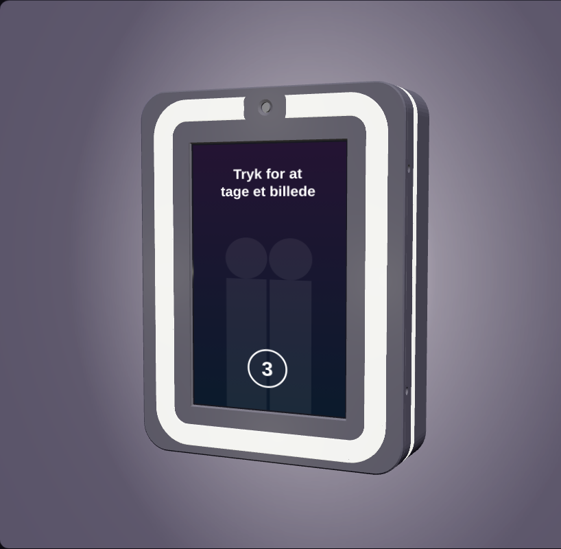
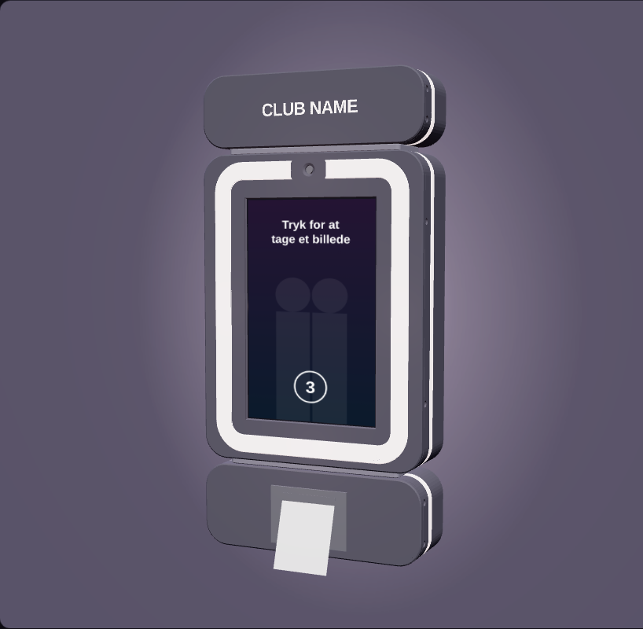
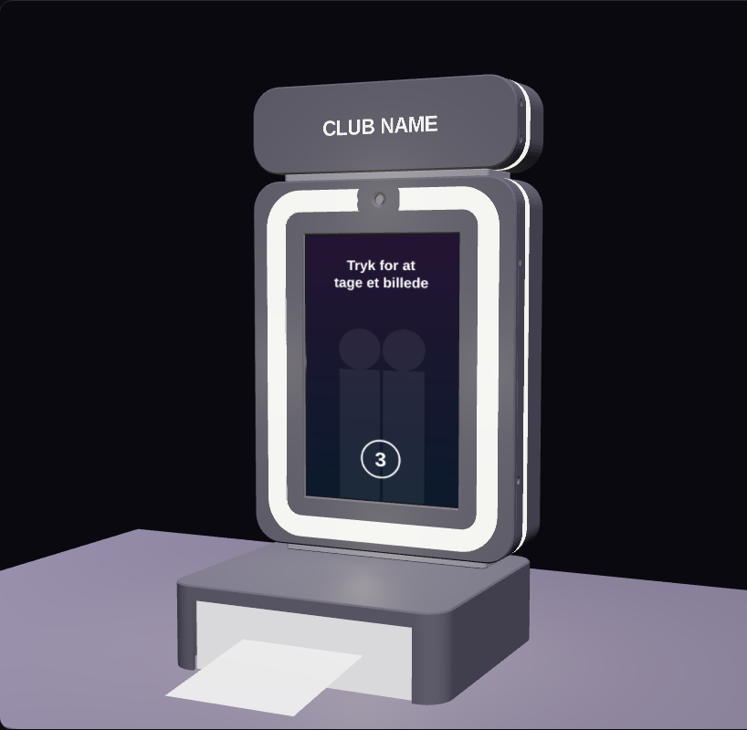
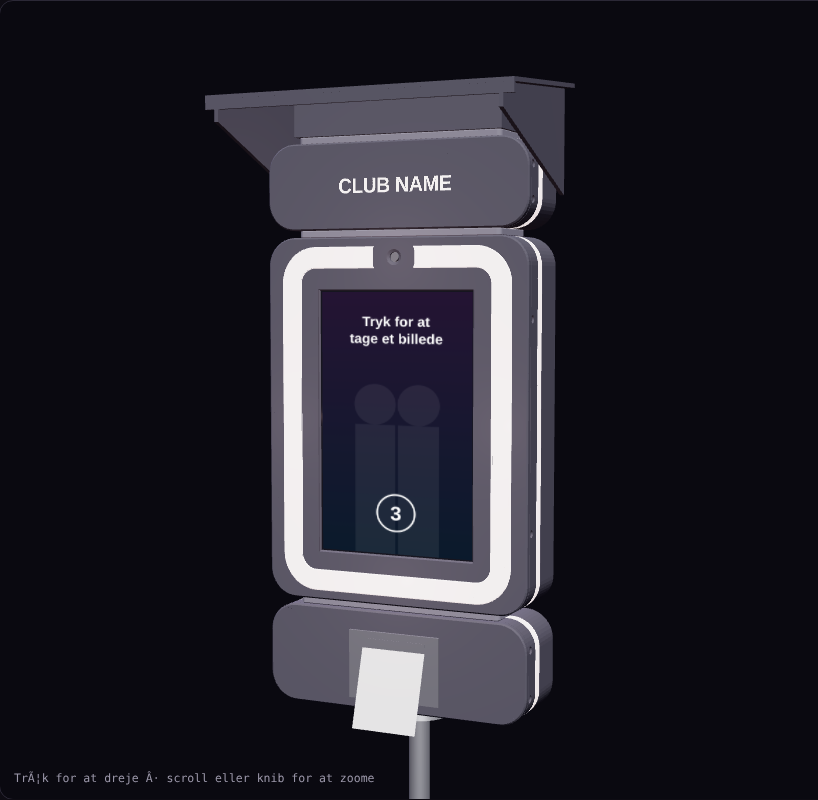

# Selfiebox "Halo Ring" – 3D-printed enclosure (rev G)

A portrait selfie box with a raised 14 mm light ring around a 10" Raspberry Pi Touch Display 2
and the camera. The enclosure is all black, with no colour details. The ring runs a high-CRI
12 V COB strip (photo light) next to an SK6812 RGBW strip (colour and animation). The unit is
234 × 306 × 66 mm and prints on a **Bambu Lab H2C** (305 × 320 × 325 mm, heated chamber).
Attachments (strip printer, SELPHY photo base, venue sign, festival roof, foot, wall cleat)
bolt on through a joint spacer.

| Unit | Nightclub wall | Bar with photo prints | Festival | Exploded |
|---|---|---|---|---|
|  |  |  |  |  |

## Files

| Path | What |
|---|---|
| `cad/components.scad` | Bought parts with every dimension and its source ([A] official, [B] CAD library, [C] measured from an official photo, [M] must be measured) |
| `cad/halo.scad` | Parametric enclosure: unit, attachments, assembly, print orientation |
| `stl/*.stl` | Print-ready, already in print orientation |
| `tools/check_bed.py` | Every STL fits the H2C plate (285 × 306 × 305 mm, ≥ 7 mm from the edges) |
| `tools/check_fit.py` | No part overlaps another, and every critical clearance is met |
| `cad/archive/` | Earlier landscape design |

```sh
openscad -D 'PART="bezel"' -D 'PRINT=true' -o stl/bezel.stl cad/halo.scad
python3 tools/check_bed.py && python3 tools/check_fit.py   # needs trimesh, manifold3d, rtree
```

## How the parts are held

| Part | Held by |
|---|---|
| 10" Touch Display 2 (166.9 × 248.1 × 15.5) | The LED rail's two cross bars press its metal back through 1 mm EVA pads. The glass sits on a 1 mm EVA ring. The light-ring ribs locate it with 1.2 mm clearance all round. |
| Camera Module 3 Wide | Rotated 90° for native portrait frames. 4 × M2×6 thread-forming screws into Ø1.7 bosses. The lens sits 1.2 mm behind the front, in a gap at the top of the ring. |
| Raspberry Pi 5 | On the display's own M2.5 stand-offs. |
| LED strips | Self-adhesive on the rail: ring runs 12 + 12 + 7 + 2 + 2 LEDs (RGBW + COB), plus a glow strip on each side. |
| Power | 2 × Pololu D36V50F5 in snap cradles. A 70 × 50 mm perfboard in slide rails. Panel DC jack. |
| Front | 2 × M3 Torx per side into brass inserts. |

## Check results

All 15 printed parts fit the H2C plate. There is no interference. Minimum clearances:
glass to ring ribs 0.5 mm, camera bosses to glass 0.5 mm, camera to shell top 1.3 mm,
glow strip to translucent stripe 5.8 mm.

## Measure before the first print

- `TD10_D`: total display depth (officially 15.5 mm). It sets how hard the cross bars press.
- Whether the picture is centred on the glass, and the Pi height on the display stand-offs (`PI_Y`).
- The exact lens centre on the Camera Module 3. The hole has ±0.8 mm tolerance, so this is only a check.

## Materials (H2C)

- Shell and front: matte black ASA, or PC for hard-use rental units.
- Diffuser ring: frosted PC or translucent PETG.
- Shell glow stripe: change to translucent at 34.0 mm and back at 44.0 mm.
