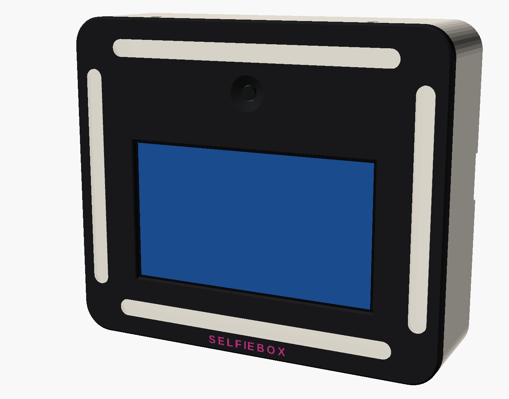
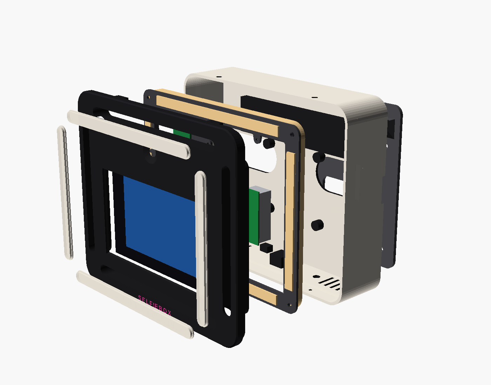

# Selfiebox "Halo" – 3D-printed enclosure

An enclosure that is printed entirely on a Bambu Lab P2S Combo (256 × 256 × 256 mm, AMS 2 Pro).
Four diffused light bars frame a landscape 7" screen. The camera sits above the screen at eye height.
A translucent stripe printed into the shell glows all the way around the body, and an LED strip on the
back lights the wall. Together they keep the unit noticeable when nobody is using it. The same unit hangs on a wall plate, sits on a
desk stand, screws onto a tripod (1/4"-20) or mounts on a VESA 75 arm.




## Files

| Path | What |
|---|---|
| `cad/halo.scad` | Parametric source. All parts, the assembly and print orientation |
| `stl/*.stl` | Print-ready, already rotated to print orientation |

Export a part:

```sh
openscad -D 'PART="bezel"' -D 'PRINT=true' -o stl/bezel.stl cad/halo.scad
```

`PART` can be `assembly`, `bezel`, `shell`, `diffuser_top`, `diffuser_side`, `led_rail`,
`display_clamp`, `camera_clamp`, `wall_plate`, `desk_stand` or `logo_inlay`.
Set `EXPLODE=1` for an exploded view of the assembly.

## Measure before the first print

These values are not confirmed. Each one is a single line at the top of `halo.scad`:

- `GLASS_T`: display glass + touch layer thickness (default 2.0 mm)
- `ACTIVE_DZ`: vertical offset of the visible picture relative to the glass centre (default 0)
- `CAM_LENS_FROM_TOP`: lens centre measured from the top edge of the camera board (default 9.5 mm)
- Insert hole diameters: `INS_M3_D` 4.0, `INS_M4_D` 5.6, `INS_Q_D` 7.9. Match these to the inserts you buy.

The model is built around the official Raspberry Pi 7" Touch Display (800×480), which the current
software uses. If you switch to Touch Display 2, update `GLASS_*` and `ACTIVE_*`.

## Print list

| Part | Qty | Material | Orientation / notes |
|---|---|---|---|
| bezel | 1 | PETG HF | Face down on the **textured PEI** plate. The 0.6 mm logo inlay is the first 3 layers (AMS colour swap) |
| shell | 1 | PETG HF + PETG translucent | Back down. **Change filament to translucent at 34.0 mm and back at 44.0 mm**. That stripe is the glow ring. Fuzzy skin on outer walls |
| diffuser_top | 2 | PETG translucent | 100 % infill. Press in from the back (or co-print with the bezel on an AMS) |
| diffuser_side | 2 | PETG translucent | Same as above |
| led_rail | 1 | PETG black | Flat, edge wall up. Front strips on its front face, ring strip around the outside of the wall |
| display_clamp | 2 | PETG black | |
| camera_clamp | 1 | PETG black | |
| wall_plate | 1 | PETG | 4 × 5 mm screws + plugs |
| desk_stand | 1 | PETG | Optional. Tilts the unit back 10° |

Use 4 walls everywhere so the brass inserts sit in solid plastic. Use 0.16 mm layers for the shell.
Use PETG throughout: translucent and opaque PETG fuse into one solid part, and ASA or PLA do not bond
well to it. Avoid PLA for the bezel and shell anyway, because it softens at about 55 °C.
For glow under club UV with the power off, print the ring and diffusers in a fluorescent translucent PETG.
The logo can be glow-in-the-dark PETG; it is abrasive, and the P2S's hardened-steel nozzle handles it.

## Hardware

Inserts: M3 ×7 (4 closure, 2 display clamp, 1 lock), M4 ×4 (VESA), 1/4"-20 ×1 (tripod).
Screws: M3 × 8 button head ×5 (Torx with security pin recommended), M2.5 × 6 self-tapping ×6.
Other: 1 mm EVA foam tape for the glass, a 5.5/2.1 mm panel DC jack (8 mm hole) and 2 × Wago 221.

## Electronics

- 5 V 6 A external brick (Mean Well GST60A05). It plugs into the DC jack in the bottom.
- Front light: SK6812 RGBW, 60 LED/m, 10 mm. Segments of 11 + 11 + 8 + 8 LEDs, joined at the corners.
- Edge ring: 46 LEDs wrapped around the outside of the LED rail's wall, shining into the translucent stripe.
- Back halo: about 44 LEDs in the groove on the back.
- Chain order: front bars → edge ring → back halo (128 RGBW LEDs in total).
- Optional: an LD2410 mmWave presence sensor, so the lights react when someone walks past.
- Data: GPIO10 (SPI MOSI) → 74AHCT125 → LEDs. SPI works on both the Pi 4 and the Pi 5.
  Add up the requested channel values every frame and scale everything down if the LEDs would draw
  more than 3 A, so the Pi never browns out. Idle attract mode draws about 0.4–1.5 A.

## Assembly

1. Install the inserts.
2. Press the diffusers in from the back.
3. Put foam on the glass edges. Lay the display in 3 mm high, then slide it down under the two bottom lips.
4. Screw on the two display clamps.
5. Fit the camera and its clamp.
6. Mount the Pi on the display stand-offs.
7. Fit the LED rail with the front strips and the ring strip.
8. In the shell, fit the DC jack and the back halo strip.
9. Close the shell with 2 screws on top and 2 underneath.
10. Hang the unit on the wall plate and fit the lock screw from below.
