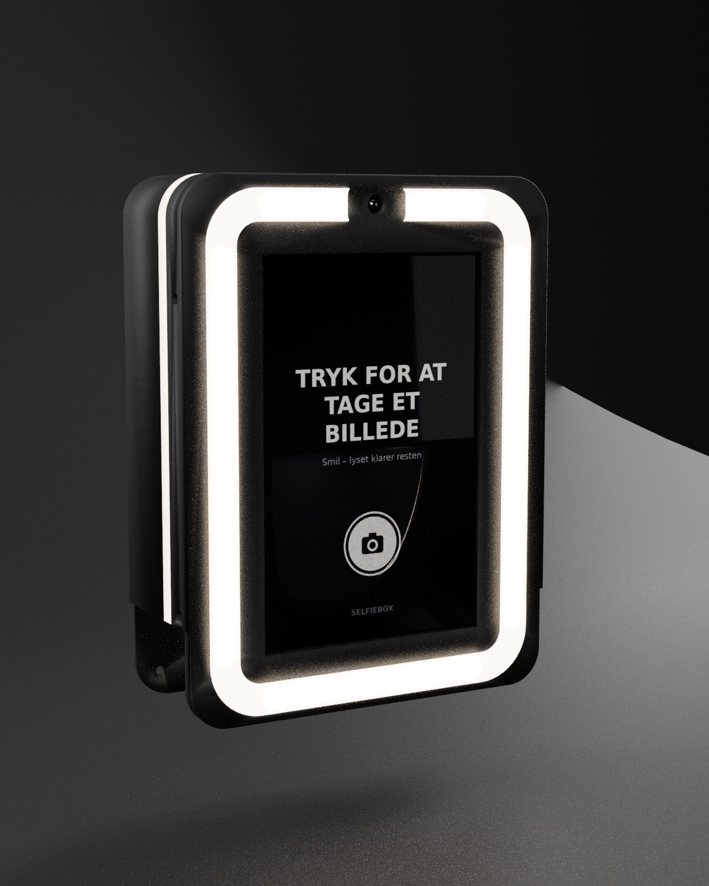
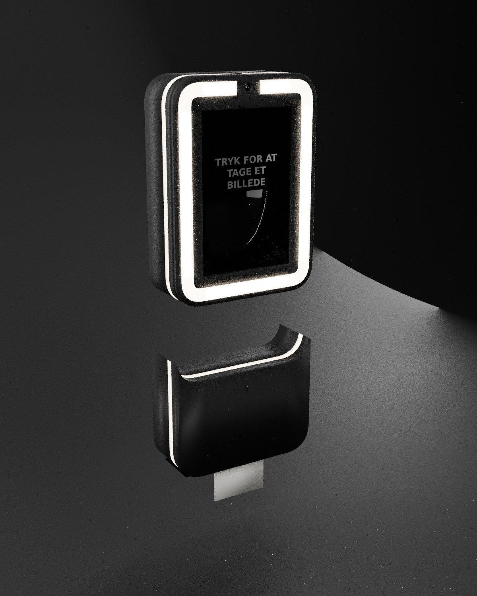
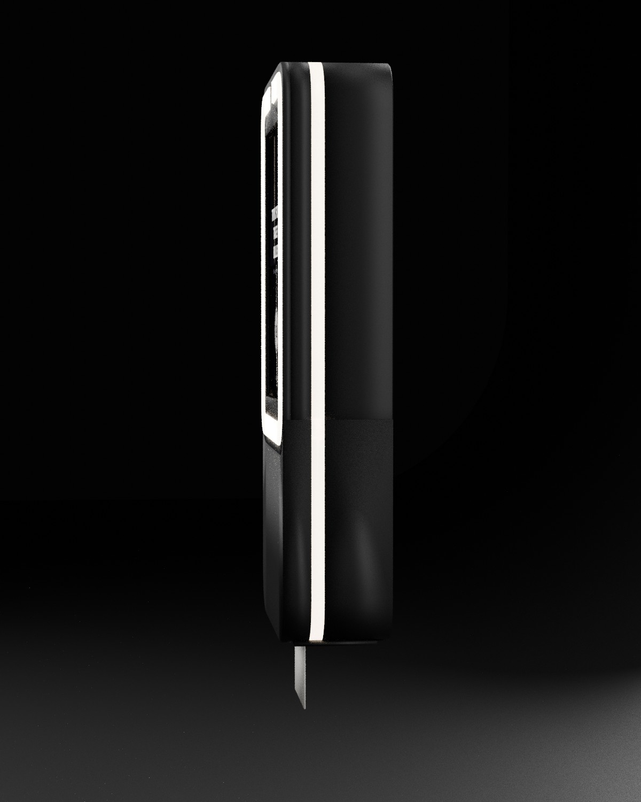
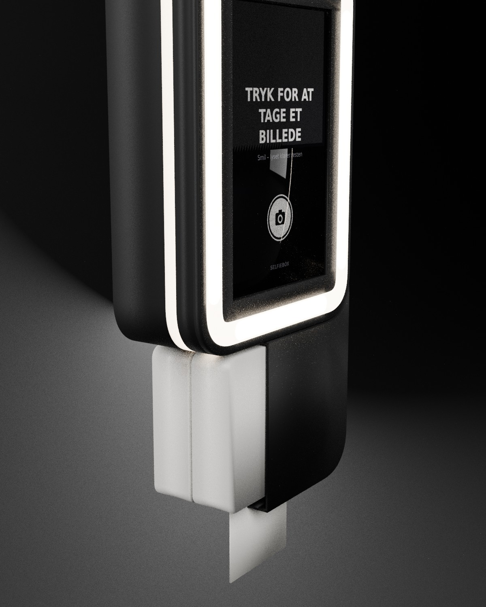

# Selfiebox "Halo Ring" – 3D-printed enclosure (rev G)

A portrait selfie box with a raised 14 mm light ring around a 10" Raspberry Pi Touch Display 2
and the camera. The enclosure is all black, with no colour details. The ring runs a high-CRI
12 V COB strip (photo light) next to an SK6812 RGBW strip (colour and animation). The unit is
234 × 306 × 66 mm and prints on a **Bambu Lab H2C** (305 × 320 × 325 mm, heated chamber).
It hangs on a wall cleat. Wall-mounted attachments (the photo module below, optional festival
roof or theme topper above) bolt on through a joint spacer. The photo module (234 × 189 × 66 mm)
holds a Fujifilm Instax Square Link upside down: colour instant photos (62 × 62 mm) drop onto a
45° ramp into a pocket behind the front window. The Pi prints over Bluetooth (InstaxBLE) and
keeps the printer charged over USB. The thermal strip printer was replaced (black and white only). The sign, SELPHY photo base and table foot
were dropped; their modules stay in `cad/halo.scad` but are no longer built.

**The current design is gen 2** (`cad/gen2_concept.scad`, drawings and renders in `docs/gen2/`):
222.5 × 306 × 85 mm, a 1:1 concentric outline with continuous-curvature corners and the same 7.8 mm
border all round, and the front held by four M3 screws from the back in the ring's corners (no side
screws). Gen 2 builds on `cad/halo.scad`, so the rev G description below still holds for everything gen 2
does not change. The STL files in `stl/` are still rev G until gen 2 gets its own print files.

| Gen 2 main unit | Exploded | Side | Section |
|---|---|---|---|
|  |  |  |  |

## Files

| Path | What |
|---|---|
| `cad/components.scad` | Bought parts with every dimension and its source ([A] official, [B] CAD library, [C] measured from an official photo, [M] must be measured) |
| `cad/halo.scad` | Parametric enclosure: unit, attachments, assembly, print orientation |
| `stl/*.stl` | Print-ready, already in print orientation |
| `tools/check_bed.py` | Every STL fits the H2C plate (285 × 306 × 305 mm, ≥ 7 mm from the edges) |
| `tools/check_bodies.py` | Every gen 2 print file is one solid body (no loose pieces in the slicer) |
| `tools/check_fit.py` | No part overlaps another, and every critical clearance is met |
| `bom/indkobsliste.csv` | Shopping list with prices (DKK incl. VAT) and filament per part. Only the main unit is in the main price; attachments, themes and tools have their own sums. Regenerate with `python3 tools/make_bom.py` |
| `cad/gen2_concept.scad` | Gen 2 (current design), built on top of `halo.scad` |
| `stl/stativbeslag/<version>/` | Stand bracket for the B2C floor tripod (gen 2 on the wall cleat, shelf with a 1/4"-20 T-nut under the centre of gravity, logo on the back): `tools/make_stativbeslag.py`, drawing `render/drawing/draw_stativbeslag.py` |
| `docs/gen2/` | Gen 2 renders (`render/render_gen2.py`) and the CAD line sheet (`tools/gen2_sketches/make_cad_sheet.sh`) |

```sh
python3 tools/make_bom.py
openscad -D 'PART="bezel"' -D 'PRINT=true' -o stl/bezel.stl cad/halo.scad
python3 tools/check_bed.py && python3 tools/check_fit.py   # needs trimesh, manifold3d, rtree
```

## How the parts are held

| Part | Held by |
|---|---|
| 10" Touch Display 2 (166.9 × 248.1 × 15.5) | The LED rail's two cross bars press its metal back through 1 mm EVA pads. The glass sits on a 1 mm EVA ring. The light-ring ribs locate it with 1.2 mm clearance all round. |
| Camera Module 3 Wide | Rotated 90° for native portrait frames. 4 × M2×6 thread-forming screws into Ø1.7 bosses. The lens sits 1.2 mm behind the front, in a gap at the top of the ring. |
| Raspberry Pi 5 | On the display's own M2.5 stand-offs. |
| LED strips | Self-adhesive on the rail: ring runs 12 + 12 + 7 + 2 + 2 LEDs (RGBW + COB), plus a glow strip on each side. |
| Power | 2 × Pololu D36V50F5 in snap cradles. A 70 × 50 mm perfboard in slide rails. Panel DC jack. |
| Front | 2 × M3 Torx per side into brass inserts. |

## Check results

All 15 printed parts fit the H2C plate. There is no interference. Minimum clearances:
glass to ring ribs 0.5 mm, camera bosses to glass 0.5 mm, camera to shell top 1.3 mm,
glow strip to translucent stripe 5.8 mm.

## Measure before the first print

- `TD10_D`: total display depth (officially 15.5 mm). It sets how hard the cross bars press.
- Whether the picture is centred on the glass, and the Pi height on the display stand-offs (`PI_Y`).
- The exact lens centre on the Camera Module 3. The hole has ±0.8 mm tolerance, so this is only a check.

## Materials (H2C)

- Shell and front: matte black ASA, or PC for hard-use rental units.
- Diffuser ring: frosted PC or translucent PETG.
- Shell glow stripe: change to translucent at 34.0 mm and back at 44.0 mm.

## Event themes

One `themes/<id>/theme.json` controls the printed theme parts (side wings, topper, sign and
printer fronts with 0.8 mm multicolour inlays), the ring-light colours, the screen UI (bands,
ticker, colours) and the frame added to each photo. The enclosure itself stays black and unchanged.
The wings use the existing side screws (M3 × 12). The topper sits on the top joint spacer.

```sh
cp -r themes/sommernat themes/<id>          # edit palette, roles, style, texts
python3 hardware/tools/theme_builder.py themes/<id>
SELFIEBOX_THEME=<id> python3 app.py
```

The builder writes an STL per colour, a 3MF per part and previews to `themes/<id>/build/`, and the
screen files to `static/themes/<id>/`. Styles: `waves`, `neon`, `confetti`. Edges: `hills`, `clouds`,
`spikes`. For your own artwork, put one SVG per colour in `themes/<id>/art/<part>/<order>_<colour>.svg`.
Use an event's own artwork only with its permission.

## Venue themes

`tools/venue_themes.py` builds hand-designed themes for one venue each: Smukfest, Roskilde Festival,
Nibe Festival, Fårup Sommerland, LEGOLAND Billund and Aalborg Zoo. Every part has its own silhouette
(a beech canopy, the Orange Scene canopy, pine forest, a roller-coaster loop, a stack of bricks with
studs, a giraffe) with the venue's logo inlaid, and the casing colour, ring light, idle screen and
photo frame follow the same palette. The mounting geometry is theme_builder's: 4 mm wing rib on the side
screws (M3 × 12), topper on the joint spacer (2 × M3 × 16, two dowels), 0.8 mm inlays printed face down.
Every part is checked against the H2C plate.

```sh
python3 hardware/tools/venue_themes.py            # all six, or name one: ... venue_themes.py legoland
```

Output per theme in `themes/<id>/build/`: a 3MF per part (all colours), previews, and (not committed,
regenerated) one STL per colour plus `web/` assets for selfi.dk. The LEGOLAND logo is traced from the
park's own brand package (`tools/logos/`); the other marks are drawn after each venue's design rules.
These are concept designs for internal use: swap in the official artwork (`tools/logos/<id>.geo.json`,
one geometry per colour) and get the venue's permission before any of it leaves the house.
