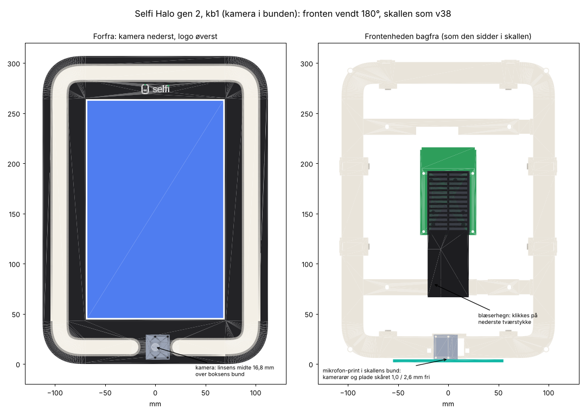

# Selfi Halo gen 2, kb1 (kamera i bunden): printguide

**Version:** halo-gen2-kb1 (1. nov. 2026). En **prøveversion ved siden af v38**, ikke en afløser: v38 er stadig den gældende boks. Alle filer i denne mappe starter med `halo-gen2-kb1_`. CAD-kilden er `hardware/cad/gen2_kamera_bund.scad` i esbenchristensen/selfiebox (en kopi af v38's `gen2_concept.scad` med fronten vendt).

Printer: Bambu Lab H2C. **Print fra 3MF-filerne** (se Indstillinger); STL-filerne ligger også i printretning. Én del pr. plade, 1 stk. af hver. Alle dele i PLA, lysringen i klart materiale.

## Hvad er kb1

Esben 1. nov., efter at have prøvet en Myselfie: "Prøv at lave en model a-z som har kamera i bunden ... Lav det som en sekundær version i admin system, så vi ikke forstyrrer nuværende design."

Hele **frontenheden er vendt 180°** i den samme skal: front, lysring, bagramme, skærm, kamera, strips, Pi og blæserhegn. Kameraet sidder nu **nederst** midt i lysringen, logoet **øverst**, og skærmen står over kameraet, lige foran gæsten. Skallen, vægbeslaget, stativbeslaget, temaerne og alt elektronikken i skallen er præcis som i v38. Boksen åbner stadig som en bog over **venstre** side.

Billedet: `halo-gen2-kb1_oversigt.png`.

### Hvad skal printes nyt, og hvad kan genbruges fra v38

| Del | kb1 | Hvorfor |
|---|---|---|
| **Front** | **Ny** | Logoet er flyttet op (så det står rigtigt), og frontens 4 klikkanter i siderne er flyttet, så de stadig rammer skallens riller ved 95 og 215 mm, når fronten er vendt (vendt ville de sidde ved 92 og 212). Top og bund er symmetriske og uændrede. |
| **Bagramme** | **Ny** | Slidserne til hængselbundterne K1 og K2 er spejlet, så de stadig sidder ude til venstre ved hængslet (x −76), og slidsen til Pi'ens strøm ved x −34. De 2 nederste kamerarør er skåret flade 1,0 mm over mikrofon-printet, og pladen bag kameraet slutter 2,6 mm over bunden (v38: 0,3), så mikrofonens flade kabel ikke klemmes. Se "CAD-tjek". |
| **Blæserhegn** | **Ny** | Hegnet hænger nu 48 mm længere nede, ud for 5 V-forsyningens bakke. Bagsiden er aflastet 0,5 mm over bakkens venstre væg (x 7,5–21, ud for den massive bjælke bag risten), så der er 1,06 mm luft. Risten og stoppindene er uændrede. |
| Lysring | Samme del som v38 | Den er bare monteret vendt. En printet v38-ring kan bruges. |
| Skal, vægbeslag, stativbeslag, temaer, Dominance-kittet, Wago-række | Samme som v38 | Uændrede (samme rumfang og mål til 0,01 mm). Printede v38-dele kan bruges. |

### Software: to indstillinger pr. boks

Agenten og kiosken kan det allerede; der skal ikke laves en ny boks-release. I admin › **Bokse** › boksen › kamerakortet:

1. **Vend skærmen**: slå til. Hele skærmbilledet og touch vendes 180°.
2. **Kameraets retning**: **270°** (v38 er 90°). Tjek på live-billedet, at personen står op.

Det samme kan sættes i `/etc/selfiebox/box.toml` på boksen: `screen_flip = true` og `rotation = 270`. Lysringen styres som før; WLED-strippens rækkefølge løber nu den anden vej rundt, men der er ingen effekter, der afhænger af retningen.

### Højde på stativet

Boksen står altid helt lodret (Esben 1. nov.: den bliver aldrig vippet). Linsens midte sidder **16,8 mm over boksens bund**, og skærmens midte 154 mm over bunden.

- Start med **linsen ca. 150 cm over gulvet** (boksens bund ca. 148 cm). Så er skærmens midte ca. 164 cm oppe, lige omkring en voksens øjne, og kameraet ser let opad på ansigtet uden at få loftet med som ved et kamera i toppen.
- Tag prøvebilleder med en lav og en høj person på 1–1,5 m, og flyt 5 cm ad gangen. Højden er et skøn ud fra Myselfie-billederne (kamera ca. 10–15 cm under øjnene), ikke målt.
- Med kameraet under øjnene lander genskinnet fra lyset ved kameraet i toppen af brilleglasset, som hos Myselfie (brilleglas hælder ca. 8°).

### Ledninger: nye længder

Ledningsplan: `halo-gen2-kb1_ledningsplan.png`. Ledningsdiagrammet er elektrisk det samme som i v38: `halo-gen2-kb1_ledningsdiagram.png` (kopi). Alle ledninger i skallen har samme længde som i v38. Det, der ændrer sig, er ledningerne fra fronten:

| Id | Ledning | kb1 | v38 | Hvorfor |
|---|---|---|---|---|
| S1–S7 | Strip-ledningerne | **600–700 mm** | 450–550 | De kommer nu ud ved kameraet forneden og skal hele vejen rundt og op til Wago-rækken foroven. S2 og S4 skal bruge 700 mm. |
| P12 | Pi'ens strøm (USB-C-pigtail) | 600 mm | 550 | |
| U1 | USB-A → RGB-styring | 550 mm | 450 | |
| U2 | USB-A → mikrofon-kerne | 500 mm | 550 | |
| U3 | USB-A → 4G-modem | 500 mm | 450 | |
| G1 | GPIO → dæmper | 450 mm | 400 | |
| G2 | GPIO → reed | 500 mm | 400 | |
| G3 | GPIO → stødsensor | 700 mm | 600 | |
| K1, K2 | Hængselbundterne | 200 mm mellem stropperne | 200 | |

- **Strip-ledninger:** 70 cm-ledningerne fra LEDprodukter.dk rækker lige akkurat (S2 og S4 bruger 700 mm). **Bestil 80 cm** til de næste strips til kb1.
- **USB-A-stikkene:** Pi'ens USB-porte vender nu **opad**. De 3 vinklede USB-A-stik skal stadig sende kablet **mod venstre** (som boksen står), mod K2 i det øverste tværstykke. Det er **den modsatte vinkel af v38's kabler**: sættes et v38-kabel i, peger kablet mod højre. Køb USB-A 90° i den anden vinkel (venstre/højre-vinklet, ikke op/ned).
- **K1 og K2 har byttet plads:** K1 (strips, Pi-strøm, dæmper, reed) går fra bagrammens **nederste** tværstykke til skallens nederste løkke (72 mm oppe i venstre side). K2 (de 3 USB-kabler og stødsensoren) går fra det **øverste** tværstykke til skallens øverste løkke (240 mm). Begge sidder ude til venstre ved hængslet.
- **Mikrofonens flade kabel** (20 cm): lige bagud ud af lommen under pladen bag kameraet, op mellem RGB-styringen og 5 V-bakken ca. 8 mm bag blæserhegnet, og ind i kernens underkant. Ruten er 159 mm. Det må ikke ligge hen over hegnet.

### CAD-tjek (1. nov. 2026)

Alle dele i deres samlede plads mod hinanden (`hardware/tools/check_fit_gen2.py` med `GEN2_SCAD=cad/gen2_kamera_bund.scad`): **ingen kollisioner**. Det, der var galt i den første vending, og som er rettet:

- De 2 nederste kamerarør ramte mikrofon-printet i skallens bund (31 mm³). Nu skåret flade 1,0 mm over printet. Deres knusspidser er flyttet til 0°/180°/270°, så alle 3 stadig trykker på kameraet.
- Pladen bag kameraet stod 0,3 mm over bunden, lige over mikrofonens flade kabel. Nu 2,6 mm.
- Blæserhegnet var 0,56 mm fra 5 V-bakken (krav 1,0). Nu 1,06 mm.

Øvrige mål: kamerakortets underkant 1,25 mm foran mikrofon-printet; mikrofon-printet 0,81 mm under frontens kanalvæg; linsen 0,69 mm fri af vinduets kant; synsfeltet fri af vinduet (0,15 mm). Synsfeltet (120°) ser ingen af temaets vinger, Dominance-stolperne eller stativbeslaget: vingerne stikker kun 3 mm frem ved x ±100, det er 88° ud fra linsens akse. Kamerakablet (fladt, 16 mm) har mindst 3,7 mm til skallen og 4,7 mm til RGB-styringen på vej op til Pi'en. Hver printfil er én lukket krop, og lysringen printer stadig uden overhæng (`make_3mf.overhang_check`).

**Samling, rækkefølge:** fronten samles liggende som før (lysring, skærm, strips, kamera, bagramme, Pi, blæserhegn) og lukkes ned i skallen over hængslet. Mikrofon-printet ligger i skallen først; kamerarørene og pladen kommer ned over det med 1,0 og 2,6 mm luft og bevæger sig til sidst lige bagud, så de ikke kan skubbe til det. Blæserhegnet går lige ned foran 5 V-bakken med 1,06 mm luft. Alle tag og stik i skallen er urørte.

**Andre ting at vide**

- Pi'en sidder 15 mm højere i boksen. Active Coolerens varme luft fra kølefinnerne går nu nedad i boksen i stedet for opad; boksen køler gennem væggene som før.
- Frontens vandafvisende kanter sidder nu foroven. Som v38 er kb1 til indendørs brug og under tag.
- Vil I prøve at dæmpe genskinnet endnu mere: sluk lysringen lige omkring kameraet i det øjeblik, billedet tages (det kræver et WLED-segment for den del og en lille ændring i agenten).

## Delene

| Fil | Del | Mål på pladen (mm) | Materiale | Plade | Support |
|---|---|---|---|---|---|
| `halo-gen2-kb1_front.stl` (+ `halo-gen2-kb1_front_flerfarvet.3mf`) | **kb1: ny.** v38's front vendt: kameravinduet forneden, logoet foroven, sidernes klikkanter flyttet til skallens riller. Ellers som v38 (klik i top og bund, Ø8,6 kameravindue med Ø10 bagved, forstærkede hjørner) | 224,5 × 307 × 27,7 | PLA sort + hvid + grøn | Tekstureret PEI | Nej |
| `halo-gen2-kb1_logo-hvid.stl` / `halo-gen2-kb1_logo-groen.stl` | Logoets farvedele til fronten (nu foroven) | | PLA hvid / grøn | Sammen med fronten | Nej |
| `halo-gen2-kb1_lysring.stl` (+ `.3mf`) | Samme ring som v38, monteret vendt | 209,1 × 291,6 × 6,7 | Klar PETG | Tekstureret PEI | Nej |
| `halo-gen2-kb1_bagramme.stl` (+ `.3mf`) | **kb1: ny.** K1/K2-slidser ved x −76 på begge tværstykker, Pi-strøm ved x −34, de 2 nederste kamerarør flade 1,0 mm over mikrofon-printet, pladen bag kameraet 2,6 mm over bunden | 217,1 × 297,6 × 29,2 | PLA hvid | Glat PEI | Nej |
| `halo-gen2-kb1_blaeserhegn.stl` (+ `.3mf`) | **kb1: ny.** Som v38, men aflastet 0,5 mm bagpå ud for 5 V-bakken; klikkes på det **nederste** tværstykke | 125,5 × 14,6 × 41 | PLA sort | Glat PEI, på siden | Nej |
| `halo-gen2-kb1_skal.stl` (+ `halo-gen2-kb1_skal_support.3mf`) | Som v38 | 224,5 × 307 × 64 | PLA sort | Glat PEI | Kun de 2 steder i 3MF'en |
| `halo-gen2-kb1_vaegbeslag.stl` (+ `.3mf`) | Som v38 | 189 × 284,5 × 19,5 | PLA sort | Glat PEI | Nej |
| `halo-gen2-kb1_stativbeslag.stl` + logo (+ `halo-gen2-kb1_stativbeslag_flerfarvet.3mf`) | Som v38 (gevindindsats 1/4"-20) | 222,5 × 304 × 54 | PLA sort + hvid + grøn | Tekstureret PEI | Nej |
| `halo-gen2-kb1_tema-*` og `halo-gen2-kb1_tema-dominance-*` | Som v38 | | PLA | Glat PEI | Under stropperne |
| `halo-gen2-kb1_wagoraekke-eftermontering.stl` (+ `.3mf`) | Som v38 (kun til en skal fra v24–v28) | 164,6 × 15,7 × 22,3 | PLA sort | Glat PEI | Nej |

Tegninger kopieret fra v38, fordi delene er de samme: `halo-gen2-kb1_laas.png`, `halo-gen2-kb1_rille.png`, `halo-gen2-kb1_snit_kroge.png`, `halo-gen2-kb1_snit_lysring.png` (ringens profil, uændret), `halo-gen2-kb1_frontskrue.png` (skruerne sidder symmetrisk i hjørnerne), `halo-gen2-kb1_tema-dominance.png`, `halo-gen2-kb1_styrketest_kroge.md`. Historikken (v2–v38) står i v38's printguide.

## Indstillinger (Bambu Studio)

**Hver del har sin egen 3MF med indstillingerne lagt ind** (v26; Esben 27. okt.: et pænt resultat uden fejl, der ser støbt ud og holder). Åbn 3MF'en, ikke STL'en, og vælg **"Open as project"** (åbn som projekt), ikke "Import geometry only". Så får hver del de samme lag, vægge, fyld, søm, support og brim hver gang, uanset hvad der sidst stod i Bambu Studio. Indstillingerne ligger på objektet; i objektlisten har det et tandhjul, og der kan du se og rette dem.

**27. okt., tredje runde: filerne er nu rigtige Bambu Studio-projekter.** Indtil nu sagde Bambu Studio 2.8 *"The 3mf file has invalid config, load geometry data only"* og smed objektets indstillinger væk, fordi filerne ikke sagde, hvilken printer, proces og filament de var lavet til. Nu vælger hver fil selv:
- Printer **Bambu Lab H2C 0.4 nozzle**, proces **0.20mm Standard @BBL H2C** og filament **Bambu PLA Basic @BBL H2C** på hver plads med farverne sort, hvid og grøn, og **Bambu PETG Translucent @BBL H2C 0.4 nozzle** til lysringen (v34; v31–v33 sagde Bambu ASA, se "Hvad er nyt i v34").
- **Pladen**: tekstureret PEI til front og lysring, glat PEI (*Smooth PEI Plate / High Temp Plate*) til resten.
- **Første lag 30 mm/s** (væg og fyld) på dele, hvor første lag er forsiden (front, lysring, tema), og **Avoid crossing walls** på alle dele (v34). Processen står derfor som *0.20mm Standard @BBL H2C* med ændringer; resten (temperaturer, køling, hastigheder) er Bambus egne profiler.
- Front, lysring (v35: hvid PLA i supportens mellemlag), stativbeslag og printerens kappe og udgang (flere materialer) ligger til venstre på pladen med **prime tower** til højre for, så det ikke står i vejen.

Filerne er bygget og tjekket mod Bambu Studio 2.8.2's egen indlæsningskode, men ikke åbnet i Bambu Studio her. Får du stadig beskeden, så sig til, og brug tabellen under "Sæt det selv" imens.

| Fil | Plade | Lag | Vægge | Fyld | Andet |
|---|---|---|---|---|---|
| `halo-gen2-kb1_front_flerfarvet.3mf` | Tekstureret PEI (glat kan bruges, se herunder) | 0,2 | 2, top 4 / bund 4 | 15 % crosshatch | Forsiden: *Monotonic line* og én væg i første lag; elefantfod 0,15; ingen brim, ingen support |
| `halo-gen2-kb1_lysring.3mf` | Tekstureret PEI | 0,16 | 3 | 100 % | Alle baner *koncentrisk*, så lyset bliver jævnt uden striber; elefantfod 0,15; **ingen support og én filament (klar)** (v36: kraven er 45° og printer uden support, som i v18) |
| `halo-gen2-kb1_bagramme.3mf` | Glat PEI | **0,28** | 2, top 4 / bund 3 | 15 % crosshatch | Ingen support; ses ikke: normalt første lag |
| `halo-gen2-kb1_skal_support.3mf` | Glat PEI | 0,2 | 2, top 4 / bund 3 | 15 % crosshatch | Support: Tree (manuel), kun ved de 2 enforcere, også fra modellen; brim 3 mm; normalt første lag (bagsiden) |
| `halo-gen2-kb1_vaegbeslag.3mf` | Glat PEI | **0,28** | 3, top 4 / bund 3 | 40 % gyroid | Ingen support; ses ikke: normalt første lag |
| `halo-gen2-kb1_blaeserhegn.3mf` | Glat PEI | 0,2 | 2, top 4 / bund 3 | 15 % crosshatch | På siden; brim 3 mm; ses ikke |
| `halo-gen2-kb1_wagoraekke-eftermontering.3mf` | Glat PEI | **0,28** | 2, top 4 / bund 3 | 15 % crosshatch | Enden ned; ingen support; ses ikke |
| `halo-gen2-kb1_tema-*.3mf` | Glat PEI | 0,2 | 2, top 4 / bund 4 | 15 % crosshatch | Forsiden som fronten; Tree-support (auto) under stropperne |

Alle dele har **scarf seam** (sømmen glider ind over et stykke i stedet for at starte og stoppe ét sted) med sømmen placeret **bagud på pladen**, og alle filer ligger, så bagud på pladen er boksens **underside** (skal og bagramme er vendt 180° i forhold til STL'en). Det, der er tilbage af sømmen, sidder derfor under boksen, hvor ingen ser den. Drej ikke delene på pladen.

**Sæt det selv** (hvis en fil kun indlæses som geometri, eller du printer fra STL). Vælg printer, proces og filament som ovenfor, slå **Advanced** til øverst i procesfeltet, og find hvert felt med **søgefeltet** (forstørrelsesglasset) under dets engelske navn. Der er én del pr. plade, så du kan sætte det i den globale proces; gem den som en proces pr. del (fx "Selfi front"), så skal det kun gøres én gang.

| Bambu Studio-felt (fane) | Front | Lysring | Bagramme | Skal | Vægbeslag | Blæserhegn | Wago-række | Tema-dele |
|---|---|---|---|---|---|---|---|---|
| Layer height (Quality) | 0.2 | 0.16 | **0.28** | 0.2 | **0.28** | 0.2 | **0.28** | 0.2 |
| Wall loops (Strength) | 2 | 3 | 2 | 2 | 3 | 2 | 2 | 2 |
| Top / Bottom shell layers (Strength) | 4 / 4 | | 4 / 3 | 4 / 3 | 4 / 3 | 4 / 3 | 4 / 3 | 4 / 4 |
| Top shell thickness (Strength) | 0.8 | | 0.8 | 0.8 | 0.8 | 0.8 | 0.8 | 0.8 |
| Sparse infill density (Strength) | 15 % | 100 % | 15 % | 15 % | 40 % | 15 % | 15 % | 15 % |
| Sparse infill pattern (Strength) | Crosshatch | | Crosshatch | Crosshatch | Gyroid | Crosshatch | Crosshatch | Crosshatch |
| Infill combination (Strength) | Fra | | Fra | Fra | Fra | Fra | Fra | Fra |
| Bottom surface pattern (Strength) | Monotonic line | Concentric | | | | | | Monotonic line |
| Top surface pattern og Internal solid infill pattern (Strength) | | Concentric | | | | | | |
| Only one wall on first layer (Quality) | Til | | | | | | | Til |
| Elephant foot compensation (Quality) | 0.15 | 0.15 | | | | | | |
| Seam position / Scarf joint seam (Quality) | Back / Contour | Back / Contour | | Back / Contour | | | | Back / Contour |
| Enable support (Support) | Fra | **Til** | Fra | **Til** | Fra | Fra | Fra | **Til** |
| Type (Support) | | **Normal (manual)** | | **Tree (manual)** | | | | Tree (auto) |
| On build plate only (Support) | | **Til** | | **Fra** | | | | |
| Brim type / Brim width (Others) | No-brim | No-brim | | Outer brim only / 3 | | Outer brim only / 3 | | |
| Initial layer speed og Initial layer infill speed (Speed) | 30 | 30 | Bambus | Bambus | Bambus | Bambus | Bambus | 30 |
| Avoid crossing walls (Quality) | Til | Til | Til | Til | Til | Til | Til | Til |
| Support/raft interface, Top interface layers, Top Z distance, Top interface spacing (Support) | | **Plads 2 (hvid PLA), 2, 0, 0** | | | | | | |
| Plate type (pladen øverst i Prepare) | Textured PEI | Textured PEI | Smooth PEI | Smooth PEI | Smooth PEI | Smooth PEI | Smooth PEI | Smooth PEI |

Tomt felt: lad Bambus værdi stå. Ved front, lysring (v35), stativbeslag og printerens kappe/udgang: **Prime tower** til og **Flush into object's infill** til. Uden 3MF'en til lysringen skal kraven have en support enforcer (højreklik på ringen, *Add support enforcer*, en kasse over hele ringen fra 3,4 til 4,0 mm over pladen).

**Printer, filament og proces** (det, der ikke ligger i 3MF'en; tjek det første gang)
- Printer: Bambu Lab H2C med 0,4-dyse. Proces: Bambus 0,20 mm Standard for H2C. Filament: **Bambu PLA Basic** (eller jeres PLA med dets PLA-profil til H2C); lysringen **Bambu PETG Translucent 0.4 nozzle** (eller jeres klare materiales profil). **Aldrig en ASA-profil til PLA** (v34).
- **Første lag:** højde 0,2 mm (logoet er præcis de 4 første lag; det er Bambus standard), hastighed 30 mm/s for både væg og fyld på front, lysring og tema-dele (ligger i 3MF'en; de andre dele bruger Bambus normale), bredde 0,5 mm. Det første lag er frontens forside, så det skal lægges langsomt og ens.
- **Undgå at krydse vægge** (*Avoid crossing walls*): til på alle dele (ligger i 3MF'en, v34). Dysen kører uden om i stedet for hen over huller og flader, så der kommer færre tråde og mærker.
- Temperaturer og køling fra filamentprofilen: PLA 220 °C, plade 55 °C, **ingen kammervarme** (kammertemperatur 0; H2C'en køler selv kammeret ved PLA), køling 60–80 %. Klar PETG 245 °C, plade 70 °C, ingen kammervarme. (v31–v33 sagde her 260 °C, 100 °C og 60 °C kammer til ASA; det gav heat creep i PLA, se v34.)
- Slå *Flow dynamics calibration* til i print-vinduet, hver gang der er sat en ny rulle i.
- Ingen "hole compensation" eller skalering. Hullerne er tegnet til målet (±0,2 mm).
- Lad ydervæggenes hastighed stå, som Bambu har den. Siderne er pæne, som de er.

**Filamentet**
- **Tør filamentet før hvert stort print**: PLA 8 timer ved 55 °C, den klare PETG 8 timer ved 65 °C. Fugtigt filament giver tråde, små bobler og en ru flade, og fugtig PETG trækker mange tråde.
- Front, skal og beslag i **samme sorte PLA fra samme parti**, så farven og glansen er ens. Logoet skal være PLA ligesom fronten, ellers hæfter lagene ikke.

**Front: sådan bliver forsiden pæn**
Forsiden er det første lag. På en **glat plade** bliver hver bane et lille spejl, og man ser mønsteret, især langs kanterne, hvor de 4 vægge mødes med fyldet. Det retter 3MF'en: alle baner i forsiden ligger samme vej i samme rækkefølge (*Monotonic line*), og der er kun én væg i første lag i stedet for 4. Det, der er tilbage, kommer af pladen og første lag:
- **Tekstureret PEI giver det pæneste, mest "støbte" resultat.** Teksturen skjuler banerne helt og giver den samme matte flade overalt. Brug den, hvis I har den.
- På den **glatte plade**: vask pladen med opvaskemiddel og varmt vand, og rør ikke ved den bagefter (fingeraftryk ses i forsiden). Brug ikke lim under fronten; limen giver en mat, skjoldet forside. Lav en Z-offset-justering på den glatte plade (første lag må hverken have revner mellem banerne eller striber af for meget plast).
- Lad pladen køle under 40 °C, før fronten tages af, og bøj pladen, ikke fronten.
- Logo (AMS: sort, hvid og grøn): `halo-gen2-kb1_front_flerfarvet.3mf` har front og logo som ét objekt med tre dele på AMS-plads 1 (sort), 2 (hvid) og 3 (grøn). Tjek, at de tre pladser har de rigtige filamenter. Sæt "Prime tower" til og "Flush into object's infill" til, så spildet bliver mindre (ca. 12 farveskift, 10–15 g spild, 20–30 min ekstra). Mindste detalje i logoet er ca. 0,9–1,1 mm, så brug ikke en 0,6-dyse til fronten.
- Uden 3MF'en: træk `halo-gen2-kb1_front.stl`, `_logo-hvid.stl` og `_logo-groen.stl` ind på én gang, svar **Ja** til ét objekt med flere dele, giv delene sort, hvid og grøn, og sæt indstillingerne fra tabellen.
- Elefantfod-kompensation 0,15 mm: lysringens skyggefuge er kun 0,15 mm, og både ringen og fronten printes med forsiden ned, så uden kompensation kan de første lag klemme ringen fast i slidsen.

**Lysring** (forsiden ned på tekstureret PEI)
- Lysfladen er 1 mm tyk og printes massiv. Med koncentriske baner går hver bane rundt langs ringen, så lyset gennem den bliver jævnt; på tværs ville banerne give striber i lyset.
- Kraven hænger 2,25 mm ud over væggen på begge sider og printes derfor på support med et mellemlag i hvid PLA (v35; v27–v34 printede den uden support, og guiden sagde fejlagtigt 1,25 mm). Træk supporten af, når pladen er kølet af, og skrab rester af, så kraven ligger plant på frontpladen.
- Print lysringen i det klare materiale (PETG Translucent-profilen ligger i 3MF'en; er det ikke PETG, så vælg jeres materiales profil). Lad pladen køle helt af, før ringen tages af, så den ikke bliver skæv.

**Bagramme** (den flade bagside ned på glat PEI)
- Reflektoren er glat (v24), og de 54 knusknopper står 0,25 mm op på de flader, lysringens krave ligger på. Slib dem ikke af; de skal trykkes flade ved samlingen.
- Læberne i strip-banerne (v18) peger fremad og står på laget under. Se efter, at de er hele hele vejen rundt, og fjern trådrester i banerne og lyskanalen med en kniv. Tråde dér kaster skygger i lysringen.

**Skal** (bagsiden ned på glat PEI)
- **Support (v26):** 3MF'en har skallen som ét objekt med 2 grønne support-enforcere og 7 røde support-blockere, og support står allerede på **Tree (manuel)** med **"Kun på byggepladen" fra**. Så kommer der support præcis 2 steder:
  - i **skinnens udsparing** øverst bagpå (taget er 120 × 33 mm, 9 mm oppe; for bredt til en bro), fra pladen, og
  - under **dæmperbakkens forreste væg** inde i venstre side (en 18 mm hylde 35 mm oppe), fra bagvæggen indvendigt. Den tages ud gennem bakkens åbning.
  Alt andet i skallen er tegnet til at printes uden: strømrøret (dråbeformede huller og 45°-tag, v24), låselommerne (broer på 16 og 10 mm), vingelommerne (broer på 7 mm), kabelløkkerne (broer på 8 mm) og luftskærmene (v26: stolper). Blockerne holder dem rene, også hvis typen ved en fejl står på *Tree (auto)*.
- **Brim 3 mm** hele vejen rundt (v26; før musøre), så hjørnerne ikke løfter sig. Den sidder på bagsiden, som vender mod væggen. Skær den af med en afgratningskniv langs kanten.

**Vægbeslag:** 3 vægge og 40 % gyroid (v33); det bærer hele boksen. Ingen support (v26: hele tungen står på pladen).

**Blæserhegn** (`halo-gen2-kb1_blaeserhegn.3mf`): i sort, **på siden** (41 mm højt, armene ligger fladt i lagene) med en brim på 3 mm, fordi det er smalt og højt. Fjern trådrester i hegnets slidser med en kniv.

## Efter print (som v38)

1. Bor de 4 skruehuller i frontens hjørner rene med et 2,5 mm bor i hånden.
2. Prøv lysringen i fronten bagfra. Den skal falde på plads uden at klemme, med en lige, smal skyggefuge (0,15 mm) rundt om lysfladen, og kraven skal ligge plant på frontpladen hele vejen rundt (den hænger 1,25 mm ud i printet).
3. Prøv skærmen i fronten. Den skal falde ned mellem ribberne uden at klemme; klemmer den, skrabes ribberne let med en kniv. Se efter, at kanten foran glasset er plan.
3b. Se gennem kameravinduet: hullet til linsen (Ø8,6 i den yderste mm, Ø10 bagved, v37) skal være rundt og rent, uden trådrester.
3c. **Stativbeslaget (v37):** sæt gevindindsatsen i hylden med loddekolben (se "Hvad er nyt i v37"), før beslaget bruges.
4. Prøv kameraet på frontens 4 tappe. Det skal kunne trykkes på med fingrene uden at skære i tappene.
5. Se efter, at vinduerne i kanalens vægge er åbne, og at overkanten (den sidste bro i printet) er lige. Fjern trådrester med en kniv.

## Samling

Som v38, med fronten vendt. Det, der er anderledes, er markeret **kb1**. "Forneden" og "foroven" betyder, som boksen står.

Læg fronten med forsiden ned på et blødt underlag.

1. **Lysringen:** læg lysringen lige ned i slidsen bagfra, så 45°-kraven ligger i frontens sæde hele vejen rundt. Ringens ender ved kameraet sidder nu forneden.
2. **Skærmen:** læg skærmen i fronten med glasset ned på kanten. **kb1:** skærmen er vendt 180° sammen med fronten, så den sidder i fronten præcis som i v38. Den skal falde ned uden at blive trykket.
3. **Strips** (ledningerne loddes på; RGB ca. 887,5 mm, hvid 850 mm). Læg bagrammen på bagsiden og sæt strippene i som i v38: **RGB først** (bagerst), så **hvid 2**, så **hvid 1**. **kb1:** ledningerne går ud gennem hullerne ved siden af kameraet **forneden**. Set forfra på den færdige boks kommer hvid 1 og RGB ud i **højre** side af kameraet og hvid 2 i venstre (liggende med bagsiden op er det spejlvendt). Ledningerne skal være **mindst 70 cm** (se "Ledninger").
4. **Kameraet:** sæt kamerakablet (300 mm) i kameraet først og tryk kameraet på de 4 tappe, til kortet ligger fladt. Intet må røre linsen. **kb1:** kameraet sidder forneden; kablet går ud til siden mod slidsen som i v38.
5. **Bagrammen** lægges ned i fronten; kamerakablet gennem slidsen ved kameraet i én blød bue. Tryk ned, til alle 14 låse klikker.
6. **Skærmen skrues fast** med 4 M2,5 × 3–4 mm skruer, som i v38.
7. **Pi'en:** skærmens flade kabel i skærmen og Pi'ens DISP-stik, Pi'en på skærmens afstandsstykker, kamerakablet i en løs bue til CAM-stikket. **kb1:** Pi'ens USB-porte vender nu **mod logoet** (opad), og GPIO-stikket sidder i højre side med ben 1 nederst.
   - **Blæserhegnet** klikkes på det **nederste tværstykke** (det nærmest kameraet) midt over Pi'en: puden mod tværstykkets bagside med risten over Active Cooleren, tryk lige ned, til begge arme klikker. Tjek, at blæseren kan drejes frit med en finger gennem risten.
   - **USB-A:** sæt de 3 vinklede USB-A-stik i Pi'en **før** bagrammen skrues fast. **kb1:** stik vinklet den modsatte vej af v38, så kablet går mod venstre i bane UB over portene, til K2's slidser i det **øverste** tværstykke.
   - **Strip-ledningerne** går fra hullerne forneden langs bunden (bane FB) og op i venstre side (FL) til **K1's slidser i det nederste tværstykke**. Pi'ens strømkabel (P12) ligger i bane LB langs det nederste tværstykke og stroppes i slidserne ved x −34. GPIO-ledningerne går ned langs bane GD i højre side. Se `halo-gen2-kb1_ledningsplan.png`. Ingen ledning må ligge over hegnet.
8. **Elektronik i skallen:** præcis som v38 (5 V-forsyning, WLED-styring, dæmper, Wago-rækken W6 W5 W3 W4 W2 W1, forbindelser efter `halo-gen2-kb1_ledningsdiagram.png`, mål 24 V / 5 V før strips og Pi sættes i).
   - **Hængselbundterne (kb1, byttet om):** K1 stroppes i skallens løkke **72 mm oppe** i venstre side og i bagrammens nederste slidser; K2 i løkken **240 mm oppe** og i bagrammens øverste slidser. Mål **200 mm mellem de to stropper** på hvert bundt. Åbn kassen helt: intet må stramme. Luk den: løkkerne folder sig ind mod midten langs venstre side.
9. **Mikrofonkortet:** læg det i lommen i bunden med Seeed-logoet nedad og stikket bagud, som i v38. **kb1:** kablet går lige bagud under bagrammens plade bag kameraet (2,6 mm luft), op mellem RGB-styringen og 5 V-bakken ca. 8 mm bag blæserhegnet, og ind i kernens underkant. Det må ikke ligge hen over hegnet.
10. **Skallen** lukkes over fronten og klikker på de 8 kanter; 4 frontskruer 4,0 × 50 T20 bagfra, som i v38.
11. **Strømindgang og ophængning:** som v38. På gulvstativet: stativbeslaget på boksen, linsen ca. 150 cm over gulvet (se "Højde på stativet"), boksen helt lodret.
12. **Software:** "Vend skærmen" til og "Kameraets retning" 270° i admin (se øverst). Tag et prøvebillede.

Købedele som v38, plus: **3 USB-A 90°-kabler vinklet den modsatte vej af v38's**, og strips med **80 cm** ledninger (70 cm går lige akkurat).

## Tjek på første print (kb1)

- Står billedet op på skærmen og på live-billedet i admin, og virker touch de rigtige steder, når skærmen er vendt?
- Ligger mikrofonkortet fladt, og kan det flade kabel trækkes en smule frem og tilbage under bagrammens plade, når boksen er lukket (så klemmes det ikke)?
- Går hegnet på det nederste tværstykke uden at røre 5 V-bakken, når boksen lukkes? Kører blæseren mindst 6000 rpm i admin?
- Rækker strip-ledningerne til Wago-rækken uden at stramme, med kassen helt åben?
- Står kameraet fast på tappene uden slør, nu hvor de 2 nederste rør er skåret flade? Tag billeder tæt på og langt væk og se efter fokus.
- Højde: prøvebilleder med en lav og en høj person; send dem, så justerer vi anbefalingen.
- Resten af v38's tjekliste gælder også (v38's printguide, "Tjek på første print").

## Blæseren i software (v24)

Blæseren kører altid **mindst 6000 rpm**, så den også køler resten af boksen. To dele i selfiebox-platform:

- `box/system/install.sh` sætter Pi'ens blæserkurve, så laveste trin er PWM 200 fra 10 °C (altså altid tændt), og laver en udev-regel, så agenten må skrive blæserens PWM. Kræver `deploy-box.sh --install` og en genstart af boksen.
- Agenten (`box/agent/selfiebox_agent/fan.py`) læser omdrejningerne hvert 5. sekund og hæver PWM, til de er over 6000. Admin viser en advarsel, hvis en boks melder under 6000 rpm.
