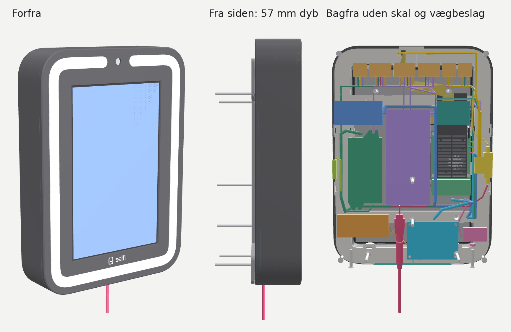
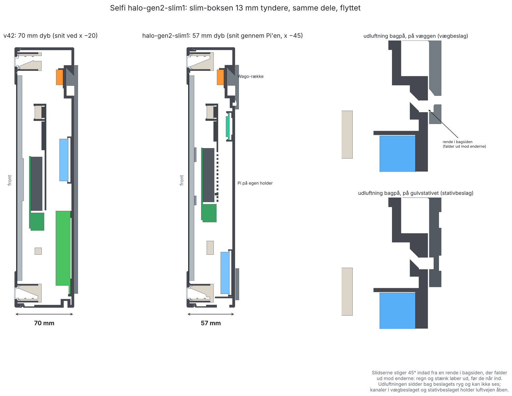

# Selfi Halo gen 2, slim12 (57 mm dyb): printguide

**Version:** halo-gen2-slim12 (5. nov. 2026). En **sekundær version ved siden af v53**, ligesom kb1 (kamera i bunden): v53 er stadig den gældende boks. Alle filer i denne mappe starter med `halo-gen2-slim12_`. CAD-kilden er `hardware/cad/gen2_slim.scad` i esbenchristensen/selfiebox. **slim12 er slim11 med faste Wago-pladser og forlængere til delene med egne ledninger (som v53): to Wago-holdere til strippene på bagrammens øverste tværstykke og to Wago-pladser ved sikringen.** slim11 var slim10 med en kabellås under strømstikket (som v52). slim10 var slim8 med en hul kølekanal i bagrammen bag lyskanalens bund, med spalter bagud (som v51); slim9 var sat af til forlængerne, som nu kommer i slim12. slim8 var slim7 med 1,8 mm under broerne over de hvide strips (som v49); slim7 var slim5 med de samme rettelser som v48 (hvid 3 på højkant gennem hjørnerne, stærkere broer og broer over hvid 3; se "Hvad er nyt i slim7"). slim6 bruges til forlængerledningerne. slim3 er sprunget over (nummeret bruges til forlængerledningerne).

Printer: Bambu Lab H2C. **Print fra 3MF-filerne**; STL-filerne ligger også i printretning. Én del pr. plade, 1 stk. af hver. Alle dele i PLA, lysringen i klart materiale. Indstillingerne er de samme som i v42 (se v42's printguide, "Indstillinger").

## Hvad er nyt i slim12 (som v53): faste Wago-pladser og forlængere til delene med egne ledninger

Samme løsning som v53 (se v53's printguide for Esbens noter og mål), tilpasset den tynde boks. Tegninger: `halo-gen2-slim12_ledningsplan.png` (klemmerne er orange) og `halo-gen2-slim12_ledningsdiagram.png`.

### Strippene: to Wago-holdere på bagrammens øverste tværstykke, foran rammens bagside

I v53 står klemmerne bag rammen. I Slim er der kun 4 mm fra rammens bagside til skallens Wago-række, og kamerakablet går der, så **her står klemmerne foran rammens bagside, i rammens vindue over tværstykket**, 1,4 mm bag skærmens bagside. Holderne klikkes på tværstykket på samme måde (plade bag tværstykket, en arm over og en fjedrende arm under), og en plade oven på tværstykket bærer lommerne frem i vinduet.

- **`wagoholder-hvid`** (x −45 til 20): 2 lommer til **221-415**, hvid + (venstre) og hvid − (højre). Den rager ikke ind over blæserhegnet (x −74 til −33): dens klips sidder i x −10 til 20, og pladen på tværstykket går 0,4 mm foran hegnet.
- **`wagoholder-rgb`** (x 21 til 84): 3 lommer til **221-413**, fra venstre data (gul), GND (hvid), +5 V (rød). Tjek farverne på din strip.
- Indgangene vender opad, håndtagene bagud mod tværstykket; med kassen åben og fronten med forsiden nedad vender de opad og kan nås gennem vinduet.
- Strippenes ledninger kommer ud af slidserne bag rammens top, går et par cm ned bag rammen og frem gennem vinduet ned i klemmerne. De bruger højst 12,5 cm (RGB +5 V), og de er 14 cm.
- Begge holdere printes på siden som blæserhegnet (begge med højre side på pladen), uden support. Ca. 8 g hver.
- **Forlængerne** går fra klemmerne tilbage gennem vinduet, langs bag rammens top til venstre og ned til K1 som før:

| Id | Fra | Til | Ledning | Klip |
|---|---|---|---|---|
| E1 | hvid + klemmen | W6 | 0,75 mm² rød | 45 cm |
| E2 | hvid − klemmen | W5 | 0,75 mm² sort | 50 cm |
| E3 | RGB +5 V klemmen | W3 | 0,75 mm² rød, orange tape | 55 cm |
| E4 | RGB GND klemmen | W4 | 0,75 mm² sort | 60 cm |
| E5 | RGB data klemmen | Gledopto GPIO16 | 0,5 mm² grøn eller gul | 65 cm |

### Sikringsholderen: to faste Wago-pladser ved den (skallen)

I Slim ligger sikringen på venstre væg, og temavingens lomme sidder lige over den, så klemmerne sidder **under og til højre** for den. Begge er **221-413** med indgangene opad:

- **Sæt sikringen i med den korte ledning (6 cm) nedad.** Den går lige ned i **FWL** på venstre væg under sikringen (bruger ca. 3,5 cm), sammen med **P1** fra hunstikket.
- Den **lange ledning (15 cm) kommer ud foroven**, går frem over holderen og ned langs dens højre side i **FWR** på bagvæggen til højre for sikringen (bruger ca. 11,5 cm), sammen med **P1b** til W1.
- FWL's håndtag vender ind mod boksen, FWR's frem. Begge vokser op fra skallens bagside og printes med skallen uden ekstra support.
- P1 er nu 25 cm, P1b 40 cm.

### Gravity-kablet og højttaleren

Som v53: Gravity-ruten er ca. 34 cm og kablet 30 cm, så forlæng med **3 dupont-ledere han-hun, 10 cm** med krympeflex over samlingen. Højttalerens kabel skal være mindst 10 cm.

### Indkøb pr. boks (nyt)

Som v53: Wago **2 × 221-415 og 5 × 221-413** ekstra, 0,75 mm² rød og sort ca. 1 m hver, 0,5 mm² grøn eller gul 65 cm, 3 dupont-ledere han-hun 10 cm og krympeflex.

### Hvad skal printes nyt

`halo-gen2-slim12_wagoholder-hvid.3mf` og `halo-gen2-slim12_wagoholder-rgb.3mf` (nye) og `halo-gen2-slim12_skal_support.3mf` (Wago-pladserne ved sikringen). Alt andet er som i slim11. Hurtigsættet `halo-gen2-slim12-hurtig` har begge holdere, et stykke af tværstykket og skallens to nye Wago-pladser på plade 1.

## Hvad var nyt i slim11 (som v52): kabellås, så strømstikket ikke kan trækkes ud

Esben 5. nov.: *"Hvordan sikrer vi os at strømstikket ikke bare bliver taget ud ved b2b vægmontering?"* og *"gælder selvfølgelig også ved gulvstanderen"*. Det samme som v52, flyttet med slim's strømindgang til x 17,65. Tegning: `halo-gen2-slim12_kabellaas.png`.

- **Kabellåsen** (19 × 31 × 8,5 mm, PLA sort, ca. 3 g) sidder under bunden ved strømstikket, 0,5 mm inden for boksens bagkant. Strømforsyningens ledning ligger i et spor i pladens overside, som bunden lukker: ned ud af stikkets kanal, frem i venstre side, i en U rundt om en **sikkerhedsskrue** (Bolte 88115, ST4,2 × 25 Torx med pin, som ved låsene) og tilbage i højre side, hvor den går ned ud af pladen 7 mm fra boksens bagkant. Ledningen bøjer ca. 360° på vejen, så et ryk ender i skruen og ikke i stikket.
- Sporet er 5,2 × 5,4 mm med 4 par knusribber (4,4 mm imellem) til en ledning på ca. Ø4,5–5,5. Lommen under stikket er Ø11 × 7 mm.
- **Skallen** har en skrueklods (Ø9, forhul Ø3,4) foran stikkets kanal. I slim står bagrammen lige foran den, så klodsen er skåret flad 0,5 mm bag bagrammen (y 32,2). Der er 1,6 mm væg foran forhullet.
- **Stativbeslaget:** slidsen i hylden har kabellåsens form med 0,5 mm luft. Hyldens højre del ud for stikket var allerede smal i slim (slidsen ved x 17,65), og den er nu skåret helt væk ud til x 30,7. Gevindindsatsen har 6 mm hylde til slidsen.
- Pasformstjek: ingen nye kollisioner.

### Sådan sættes den på

Som v52: hæng boksen op, sæt stikket op i bunden, læg ledningen i sporet (frem langs den side, der vender mod boksens venstre side set forfra, rundt om skruehullet, tilbage og ned gennem hullet bagerst), og skru kabellåsen op under bunden med den 3. sikkerhedsskrue. På gulvstanderen gennem slidsen i hylden, før kuglehovedets lynplade skrues på. Hiv i ledningen bagefter: stikket må ikke flytte sig.

### Hvad skal printes nyt

`halo-gen2-slim12_kabellaas.3mf` (ny), `halo-gen2-slim12_skal_support.3mf` og `halo-gen2-slim12_stativbeslag_flerfarvet.3mf`. Resten er som slim10. Købedele: **3 sikkerhedsskruer** (Bolte 88115) i stedet for 2. Hurtigsættet `halo-gen2-slim11-hurtig` har kabellåsen og stativets hylde på plade 1.

## Hvad var nyt i slim10 (som v51): kølekanal i bagrammen, som blæseren kan køle

Esben 5. nov.: *"lav noget som blæseren kan rotere luft igennem, den sætter vi jo til at køre altid, så køler de altid lyskanalen"* og *"vi må ikke bruge noget eksternt"*. Han valgte en åben ringkanal, hvor Pi-blæseren rører luften i boksen.

Kun **bagrammen** er ændret. Den var massiv bag lyskanalens bund (hvid 3). Nu er den hul:

- **En kølekanal hele vejen rundt** bag bunden: 12 mm bred og 8,6 mm dyb, 2,4 mm bag bunden (1,4 mm i hjørnerne), med 2,1 mm bagside og mindst 1,5 mm væg ved frontskruerne. Den er lukket ind mod lyskanalen, så **intet lys kan slippe ud** den vej. Den stopper 41 mm fra midten oppe, så klipslommerne og ledningsslidserne ved kameraet ikke ændres.
- **12 spalter i bagsiden** (9 mm brede) ind til boksen. De lave spalter sidder i bunden (3 stk.) og forneden på begge sider. De høje sidder højt på begge sider og i den øverste banes yderste ender. Siderne står lodret, så kanalen virker som en **skorsten**: varm luft stiger op og ud foroven, og køligere luft fra boksen trækkes ind forneden. Pi-blæseren kører nu altid med en stille grundfart (softwaren i selfiebox-platform) og rører luften i boksen. Bag hver spalte er der fri luft, tjekket mod alle dele. Nogle ledninger kan ligge hen over et par af dem; det gør ikke noget.
- Bagrammen bliver ca. **88 cm³ lettere** (ca. 110 g PLA), og den printes stadig med bagsiden ned uden support. Kanalens loft er en 12 mm bro.

Hvad det giver (varmemodellen 5. nov., `/mnt/project-files/lyskanal-varme/`): skorstenen trækker mere, jo varmere kanalen er. Ved en travl fest giver den ca. 1 °C, med striber i kø ca. 3-4 °C, og hvis lyset hænger, ca. 10-13 °C. Den alene holder ikke kanalen under 100 °C, hvis lyset hænger; det skal softwaren sikre.

Pasformstjek: ingen nye kollisioner. Hurtigsættet `halo-gen2-slim11-hurtig` har lysstakken nederst til venstre på plade 1, nu med kølekanalen og 2 spalter. Se efter, om kanalens loft er pænt og lukket, og at der ikke kommer lys ud gennem spalterne, når en strip lyser.

### Hvad skal printes nyt

Kun `halo-gen2-slim12_bagramme.3mf`. Alle andre filer er de samme som i slim8.

## Hvad var nyt i slim8 (som v49): 1,8 mm under broerne over de hvide strips

Esben 4. nov.: *"1.65mm tykkelse på led 2,2mm på rgb"* og *"1,66 var også under pres, så de er nok 2, men kan nemt presses ned så 1,8 er nok godt"*.

Kun **bagrammen** er ændret, og kun der, hvor de hvide strips ligger:

- Broerne over hvid 1 og hvid 2 og stængerne over hvid 3 giver nu **1,8 mm** under sig (v45 til slim7: 2,25 mm, regnet for en 2,0 mm strip plus 0,25 luft). Strippen ligger altså let presset og kan ikke rasle.
- Broerne over RGB er uændrede: 2,2 mm strip plus 0,25 mm luft.
- Slidsen i hjørnerne, hvor hvid 3 står på højkant, er nu 2,2 mm bred (slim7: 2,6).
- Broerne er stadig 2,0 × 2,4 mm.

Hurtigsættet `halo-gen2-slim8-hurtig` havde hjørnet på plade 1. Prøv om strippene glider ind under broerne med et let tryk, og om hvid 3 sidder fast i slidsen.

## Hvad var nyt i slim7 (som v48): hvid 3 på højkant gennem hjørnerne, stærkere broer og broer over hvid 3

Esben 4. nov.: *"Vi skal have lavet broer på den bagerste også"*, *"Vi klipper ikke i den. Find en anden løsning"* og *"Er de broer du har lavet holdbare nok? De må ikke knække nemt. ingen af dem må knække nemt."*

Kun **bagrammen** er ændret. Lysring, skal, front og alt det andet er de samme som i slim5. halo-gen2-slim7's snit (`halo-gen2-slim7_snit_led.png`) viste broerne, slidsen i hjørnet og hvor hvid 3 vrides.

### Hvid 3 gennem hjørnerne: vrid den op på højkant

Hvid 3 kan ikke bøje rundt om hjørnet i sit eget plan (den er 8 mm bred, hjørnet er en kurve på 26 mm, og yderkanten skulle strækkes over 20 %). Den skal heller ikke klippes. Derfor:

- Den ligger fladt på bunden under læberne, indtil der er 15 mm til hjørnet. Der stopper læberne og skinnerne.
- Derfra vrides den en kvart omgang, så den står på højkant. Midt i hjørnet står den i en slids mellem to finner (2,6 mm bred, 14 mm lang, 6 mm høj). På højkant bøjer den over sin flade side, som hvid 1 og hvid 2 gør på væggene.
- Efter hjørnet vrides den ned igen og ligger fladt under læberne, 15 mm efter hjørnet.
- Vridet fordeles over ca. 30 mm på hver side af slidsen. Det svarer til en kvart omgang på godt 3 cm, og det kan en 8 mm strip godt holde til. Vrid den ikke skarpt på et kort stykke.
- På højkant lyser den ud mod siden i hjørnet i stedet for frem mod lysringen. Lyset kastes rundt af de hvide vægge, så det er kun lidt lys, der går tabt i de fire hjørner.

### Broerne er stærkere

- Alle broer er nu **2,0 × 2,4 mm** (v45 og v46: 1,0 × 1,6). De er vokset ind mod kanalens midte, så der stadig er 0,25 mm luft over strippene.
- Stængerne langs væggene printes stående, så de bøjes på tværs af printlagene. Med 20 MPa mellem lagene og 9 mm mellem fæsterne knækkede de gamle ved ca. 5 N (et fast fingertryk). De nye holder til ca. 28 N (omkring 3 kg).
- Forfra ses enden af en bro som 2,4 × 2,0 mm bag diffuseren.

### Broer over hvid 3

- Ved hver bro, undtagen i hjørnerne, er der nu også en stang over hvid 3 på bunden. Den er 2,0 mm tyk, 0,25 mm over COB'en og går på tværs af banen med et ben ned til hver skinne. Den printes liggende hen over banen, med tråden på langs, så den er stærk.
- I hjørnerne holdes hvid 3 af slidsen i stedet. Finnerne er bundet til bunden og til væggenes stænger.
- Broerne oppe er flyttet til x ±46,5 (v46: ±54), hvor hvid 3 stadig ligger fladt.

### Sådan sættes hvid 3 i nu

1. Klipset på bunden i venstre klipslomme og ledningen i slidsen ved kameraet, som i v46.
2. Læg strippen fladt under læberne og under broerne hen mod hjørnet.
3. 15 mm før hjørnet vrider du den op på højkant og trykker den ned i slidsen forfra. Slidsen er åben fremad mellem broens to stænger.
4. Efter hjørnet vrider du den ned igen og fortsætter under læberne. Gør det samme i alle fire hjørner.
5. Sæt derefter RGB, hvid 1 og hvid 2 i som i v46.

### Hvad skal printes nyt

**Bagrammen**. Hurtigsættet `halo-gen2-slim7-hurtig` har på plade 1 `lyskanal` (hjørnet nederst til venstre med slidsen, broen og stykket, hvor hvid 3 vrides) og begge klipslommer. Prøv på hjørnet: kan hvid 3 vrides op i slidsen og ned igen uden at slå bule, og kan du trykke hårdt på broerne med en finger, uden at de knækker?

## Hvad var nyt i slim5 (som v46): ingen skråning, fire strips og broer i hjørnerne og midt på siderne

Esben 4. nov.: *"jeg sagde, at vi bruger alle tre LED-bånd ... og RGB-båndet"*, *"kunne vi eventuelt lave en i midten på hver side også"* og forslaget om at droppe skråningen helt: en hvid strip på hver sidevæg i kanalen, RGB bag den ene, og den tredje hvide på bagvæggen, så den peger lige ud mod lysringen. Han valgte "Ingen skråning, flad bund".

Kun **bagrammen** og **lysringen** er ændret. Skal, front, blæserhegn, vægbeslag, stativbeslag og temadele er de samme som i slim4 (samme STL'er og 3MF-indstillinger). halo-gen2-slim5's snit (`halo-gen2-slim5_snit_led.png`) viste kanalen, broerne og klipslommerne.

### Lyskanalen er nu en kasse (bagramme)

- Den skrå reflektor er væk. Kanalen er 13,8 mm bred hele vejen rundt, og bunden ligger 18,6 mm bag fronten (før 27,4 mm under skråningen). Bag bunden er rammen massiv, som den var under skråningen.
- **Hvid 1** sidder på ydervæggen (4,6 til 12,7 mm bag fronten), **RGB** bag den på samme væg (13,5 til 18,5 mm). **Hvid 2** sidder på indervæggen lige over for hvid 1. **Hvid 3** ligger fladt på bunden og lyser lige ud mod lysringen.
- Hvid 1 og hvid 2 har trin og skillevægge som før, nu spejlet på begge vægge. Hvid 3 ligger mellem to skinner på bunden med en 1,1 mm læbe ind over hver af dens mørke kanter (der er 2,2 mm mørk kant på hver side af den gule stribe, så læben skygger ikke).
- Lys: en 2D-strålesimulering af kanalens snit (hvide vægge 0,88, strips 0,65) gav **153 mod 100** for v45's to hvide på skråningen. Hvid 3 på 90° på skråningen gav 125. RGB bliver ca. 36 % stærkere, fordi den ikke længere sidder bag i en dyb lomme.
- Strøm: tre hvide strips er ca. 31 W af strømforsyningens 90 W. Det giver mere varme i kanalen, så ASA til front og bagramme (som planlagt) betyder mere nu.

### Broer: 9 i alt (bagramme)

- Én i hvert hjørne (ved 45°), én midt på venstre side, én midt på højre side og én midt i bunden. Oppe sidder kameraet i midten, så der er én midt i hver halvdel (x ±54).
- Hver bro er to tynde stænger, 1,0 mm tykke og 1,6 mm brede, 0,25 mm over strippenes forside: én over hvid 1 og RGB på ydervæggen (fra trinnet til hvid 3's skinne) og én over hvid 2 på indervæggen (fra trinnet til skillevæggen). De er bundet til rammen i de mørke mellemrum, så intet krydser en strip.
- Hvid 3 på bunden har ingen bro. Den holdes af læberne hele vejen rundt.

### Klipslommerne ved kameraet (bagramme og lysring)

- I begge ender af den øverste bane, fra kameraet og 21,5 mm ud (|x| 17 til 38,5), er hele kanalens bredde fri: ingen trin, skillevægge, læber eller skinner, og bunden er 1,1 mm dybere. Ledningsslidsen (x 17 til 21) går nu gennem rammen i begge halvdele.
- **Venstre lomme:** klipsene til hvid 1 (på ydervæggen) og hvid 3 (på bunden). **Højre lomme:** klipsene til hvid 2 (på indervæggen) og RGB (på ydervæggen). Hvid 1's og RGB's klips kan ikke ligge i samme side, for de ville ramme hinanden.
- Lysringen har et hak bag på sig, hvor et klips ligger op mod den: ved hvid 1's klips (yderst, venstre) og ved hvid 2's klips (inderst, højre, fra x 21). Lysringen printes stadig uden support.

### Strippenes længder

Målt langs banerne i modellen, inklusive enden i klipset, i forhold til hvid 1 (samme længde som i v45):

| Strip | Føres fra | Fri ende ved | Længde i forhold til hvid 1 |
|---|---|---|---|
| Hvid 1 (ydervæg) | venstre | kameraet, højre | samme |
| Hvid 2 (indervæg) | højre | 4 mm før kameraet, venstre | ca. 78 mm kortere (indervæggen er en kortere vej rundt) |
| Hvid 3 (bunden) | venstre | højre klipslommes yderkant (x 38,5) | ca. 59 mm kortere |
| RGB (bag hvid 1) | højre | venstre klipslommes yderkant (x 38,5) | ca. 21 mm kortere end i v45 |

Læg strippen i sin bane først og klip den frie ende til, så den slutter ved det sted, der står i tabellen.

### Sådan sættes strippene i nu

1. **Hvid 3 først**, fra venstre: læg ledningen i slidsen ved kameraet og klipset på bunden i lommen. Skub strippen ind under læberne med den frie ende først, eller læg den ene kant ind under den ene læbe og tryk den flad. Hjørnerne skal den bøje fladt om (i sit eget plan). Det er det, hurtigsættets hjørneprøve skal vise.
2. **RGB**, fra højre: klipset på ydervæggen i højre lomme, strippen bagerst på ydervæggen, frie ende først ind under hver bro.
3. **Hvid 1**, fra venstre: klipset på ydervæggen i venstre lomme, strippen foran RGB, ind under broerne.
4. **Hvid 2**, fra højre: klipset på indervæggen i højre lomme, strippen på indervæggen, ind under broerne.
5. Ud igen: træk hver strip tilbage fra klipsenden, så glider den ud under broerne og læberne.

Hvis hvid 3 ikke vil bøje fladt om hjørnerne, kan den lægges i stykker: fire lige stykker mellem hjørnerne, forbundet med ledning. RGB-strippens forlængerledning og dens stik bag på rammen kommer i en senere version (stiktypen og længderne venter på Esben).

### Hvad skal printes nyt

**Bagrammen** og **lysringen**. Hurtigsættet `halo-gen2-slim5-hurtig` har dem på plade 1: `lyskanal` (et hjørne af front, lysring og bagramme nederst til venstre med alle fire baner, broen i hjørnet og hvid 3's læber, til at prøve bøjningen) og `klipslomme` (venstre klipslomme ved kameraet).

## Hvad var nyt i slim4: plads til klipstikkene og broer i hjørnerne af lyskanalen (som v45)

Esben 4. nov.: *"de her stik og klipstik, som sidder for enden af stripsene, på nogle områder, der er de sidder placeringen på dem sådan, at de presser fronten væk fra LED-kanalen"* og *"vi skal sørge for, at det sidder fast, især rundt i hjørnerne. ... For man kan især se lyset, hvis ikke det sidder helt tæt op mod kanterne."* Han foreslog en tynd bro, som strippene kan køre under, og at starte med én i hvert hjørne.

Kun **bagrammen** og **lysringen** er ændret. Skal, front, Pi-holder, blæserhegn, vægbeslag, stativbeslag og temadele er de samme som i slim2 (samme STL'er og 3MF-indstillinger). halo-gen2-slim4's snit (`halo-gen2-slim4_snit_led.png`) viste begge ændringer.

### Lommer til klipstikkene ved kameraet (bagramme og lysring)

v36 regnede med, at strippene blev loddet uden klipstik. Strippene, der bruges, har klipstik på den ende, der føres (hvid: 8 mm COB-startklips ca. 16 × 9,6 × 4,3 mm, RGB: 5 mm MiniClip 3-polet ca. 16,6 × 6,8 × 4,4 mm). Et klips er bredere end sin strip, så det ramte skillevæggene mellem banerne, trinnet foran hvid 1 og lysringens krave (hvid 1's klips nåede 0,3 mm ind over kraven), og så stod fronten ud.

- I begge ender af den øverste bane, fra kameraet og 21,5 mm ud (|x| 17 til 38,5), er trinnet, skillevæggene, læberne og RGB-knasterne skåret væk fra stripvæggen og 4,8 mm ind. Bunden er 1,1 mm dybere der (til RGB-klipsets bredde), og reflektorens fod er skåret lidt ned bagest.
- De første 4 mm ved kameraet er ledningsslidsen som før: ledningen går ud af klipsets ende mod kameraet og bøjer bagud gennem slidsen. Klipset ligger fra x 21 og udad.
- Lysringen har samme hak bag på sin yderste væg og krave i de samme 21,5 mm (0,6 mm dybt), så et klips ikke kan røre ringen. Ringens kant mod rammen, krave og fals er ellers uændret.
- Venstre side: hvid 1 og RGB. Højre side: hvid 2. Lommen er lige stor i begge sider, så alle tre strips kan føres fra begge ender.
- RGB-knasterne på den øverste bane er rykket ud af lommen: fra x ±30 og ±55 til ±46 og ±62.

### Broer i hjørnerne (bagramme)

- Én bro midt i hvert hjørne (ved 45°, 4 i alt): en tynd stang, 1,0 mm tyk og 1,6 mm bred, der står 0,25 mm over strippenes forside (hvid: over COB-buen, RGB: over RGB-strippen), på tværs af alle tre baner fra trinnet foran hvid 1 til bunden.
- Den er bundet til rammen fire steder: trinnet, de to skillevægge (i de mørke mellemrum mellem strippene, så intet krydser en strip) og bunden. Den er altså stiv og kan ikke knække af.
- Forfra ses kun dens ende, 1,6 × 1,0 mm, 3,7 mm bag diffuserens forside. Den er hvid som rammen.
- Den printes med rammen (bagsiden ned): en lodret søjle med 1,1 mm små broer ud til trinnet og skillevæggene, ingen support.

### Sådan sættes strippene i nu

1. Læg ledningen fra klipsets ende ind i slidsen ved kameraet, og læg klipset i lommen.
2. Læg strippen ned i sin bane langs den øverste bane, ned ad siden, og træk den **frie ende ind under broen** i hvert hjørne (frie ende først; klipsenden skal aldrig under en bro). Træk resten igennem, til strippen ligger tæt i hjørnet.
3. Ud igen: træk strippen tilbage fra klipsenden, så glider den ud under broerne uden at blive bøjet.

Hvid 1 og RGB føres fra venstre, hvid 2 fra højre, som før. RGB-strippens forlængerledning og dens stik bag på rammen kommer i en senere version (stiktypen og længderne venter på Esben).

### Hvad skal printes nyt

**Bagrammen** og **lysringen**. Hurtigsættet `halo-gen2-slim4-hurtig` har de to ændringer på plade 1: `klipslomme` (front, lysring og bagramme ved kameraet i venstre side) og `lyskanal` (lysstakken nederst til venstre, nu med broen i hjørnet).

Front og bagramme skal senere printes i ASA, fordi PLA blev blødt af varmen (Esben 4. nov.). Indtil spolerne og 3MF-indstillingerne er skiftet, er alle 3MF'er stadig PLA (lysringen klar PETG).

## Hvad var nyt i slim2: mikrofontænderne, strømstikkets kanal og sikringsholderen (som v43)

Kun tre ting i **skallen** er ændret, efter Esbens hurtigprint 4. nov. Det er de samme rettelser som i v43 på hovedlinjen. Alle andre dele er de samme som i slim1.

### Mikrofonkernens tænder (skallen)

*"De tænder, du har lavet for den, de passer egentlig fint nok på den og holder fint på den. De er bare lige en tand for tynde, så de knækker for den, når man sætter dem ned."*

- **Selve tanden er uændret**, så pasformen er den samme: 6 mm bred, går 0,45 mm ind over printets kant, 0,2 mm over printets top, samme skrå top og samme sted midt på hver kort ende.
- **Tungen under tanden er stærkere:** 10 mm bred (slim1 og v40–v42: 6 mm), 1,2 mm tyk ved roden og tilspidset bagpå op til de 0,8 mm ved tanden (siden ind mod kortet er lige som før), og en 0,5 mm affasning på begge sider af roden, hvor den knækkede (før var der et skarpt hjørne).
- Lommen i bagvæggen er 2,0 mm dyb (slim1 og v40–v42: 1,5; der er stadig 1,0 mm bagvæg tilbage), så tungen er 8,6 mm lang i stedet for 8,1. Roden er ca. 3,7 gange så stærk, og tøjningen, når tungen bøjer de 0,6 mm ud, er næsten den samme som før (ca. 1,2 % mod 1,1 %), fordi den er længere og tilspidset.
- Tryk kortet lige ned over pindene; vip det ikke ind under den ene tand først.

### Kanalen til strømforsyningens stik (skallen)

*"Kanalen, som strømstikket udefra skal op i, den er måske lige en millimeter i diameter for tynd. Så stikket det har svært ved at komme op."*

- Hullet nedefra er **Ø11,8** (slim1 og v40–v42: Ø10,8), stadig med den flade top 0,5 mm over cirklen og affasningen i bunden. Der er nu 0,8 mm luft om stikkets greb (Ø10,15) hele vejen rundt.
- Intet andet ved strømindgangen er ændret: bøjlen over hunstikket og foden om hullet er som v40. Foden var tegnet efter det gamle Ø12,5-hul, så der er stadig væg rundt om, og stativbeslagets slids til stikket (ved x 17,65) er 16 mm bred, så det går fri.

### Sikringsholderens åbninger i enderne (skallen)

*"Udgangen i hver ende af sikringsholderen er blevet for smalle og snævre, så sikringsholderen kan ikke komme derned i."* Du målte ledningsstudsene til ca. 8 mm i begge ender, "måske 7,5".

- Slidserne i begge endevægge er **7,5 mm brede** (slim1 og v40–v42: 5,6; v36–v39: 9), så de klemmer 0,25 mm på hver side af studsen. Affasningen øverst i slidserne følger med.
- Lommen (13,38 mm uden luft) og knusribberne (0,5 i siderne, 0,4 i enderne) er som v40.

### Hvad skal printes nyt i slim2

Kun **skallen**. Alle andre dele er de samme som i slim1. Hurtigsættet `halo-gen2-slim11-hurtig` har de tre ændringer på plade 1 sammen med slim1's nye steder (udluftningen og det, der er flyttet), da slim1 ikke er printet endnu.

## Hvad er slim1

Esben 3. nov.: "Vi vil gerne have den så tynd som muligt", varmen klares med "mere vejrsikker udluftning bagpå, bag vægbeslaget, så man ikke kan se det, hvis den er på stativ", og "du må ikke bytte ting ud i den, men du må gerne flytte på alt". 4. nov. valgte han 57 mm med Pi'en flyttet.

- **Boksen er 57 mm dyb** (v42: 70 mm), altså 13 mm tyndere. Front, lysring, skærm og kamera er de samme; skallen, bagrammen og alt bag dem er lavet om til den nye dybde.
- **Ingen dele er byttet ud.** Det er de samme købedele som v42: RSD-60G-5, Gledopto, DFR0457, XVF3800, højttaler, 4G, Wago og sikringsholder. De er flyttet, så de ligger ved siden af hinanden i stedet for bag hinanden.
- **Pi'en sidder på sin egen holder** lavt i venstre side (v42: midt på skærmens afstandsstykker, med 5 V-forsyningen bag sig). Det er den ene nye del, og den kræver et længere fladkabel til skærmen (se "Køb").
- **Ny udluftning bagpå** bag vægbeslagets ryg: en rende i bagsiden, der falder ud mod enderne, og slidser, der stiger 45° indad fra den. Regn og stænk løber ud, før de når ind, og den kan ikke ses, hverken på væggen eller på gulvstativet. Vægbeslaget og stativbeslaget har kanaler ud for slidserne, så luften kan komme ud.

### Hvad skal printes nyt

Alt undtagen lysringen er nyt, fordi skallen er 13 mm kortere, og alt, der går rundt om den, følger med.

| Del | slim1 | Hvorfor |
|---|---|---|
| **Skal** | **Ny** | 51 mm høj på pladen (v42: 64). Alle holdere er flyttet (tabellen under "Indretning"), udluftningen bagpå er ny, slidserne i bunden er 15 mm lange, og de 2 gamle dyvler bagpå er væk. |
| **Pi-holder** | **Ny del** | Pi'en skrues på holderen med 4 M2,5 × 6, og holderen skrues på skærmens 2 højre afstandsstykker med skærmsættets egne 2 skruer. De 2 venstre afstandsstykker går gennem huller i holderen. |
| **Bagramme** | **Ny** | Venstre side-låse (mellem bagramme og front) er flyttet fra 110 og 190 mm op til **138 og 192 mm**, så Pi'ens USB-porte og ledningerne på GPIO-stikket går fri. K1's slids er flyttet til x −80. Udskæringen til USB-stikkene i det nederste tværstykke er væk (Pi'en sidder ikke længere der). |
| **Front** | **Ny** | Låsenes vinduer følger bagrammens låse i venstre side. Ellers som v42. |
| **Blæserhegn** | **Ny** | 10 mm smallere og flyttet med Pi'en (midt over x −53,5). Klikkes stadig på det øverste tværstykke. |
| **Vægbeslag** | **Ny** | Kanaler (1,5 mm dybe) ud for udluftningen. Tunger og skinne som v42. |
| **Stativbeslag** | **Ny** | Hylden er 13 mm kortere (41 mm på pladen, v42: 54), slidsen til strømstikket er flyttet til x 17,65, og der er kanaler ud for udluftningen. Gevindindsatsen er som v42. |
| **Tema-dele og Dominance** | **Nye** | Stropperne går rundt om den tyndere boks (64,1 mm i stedet for 77,1). |
| Lysring | Samme del som v42 | En printet v42-ring kan bruges. |

Wago-rækken til eftermontering (`wagoraekke-eftermontering`) er ikke med: den var til skaller fra v24–v28.

### Indretning (set bagfra med skallen åben, mål i mm fra boksens bund og midte set forfra)

| Del | Hvor | v42 |
|---|---|---|
| 5 V-forsyning (RSD-60G-5) | Står mellem tværstykkerne til højre for Pi'en, x −24 til 36, 90–218 oppe. DC IN foroven, DC OUT forneden, skruerne fremad | Bag Pi'en |
| RGB-styring (Gledopto) | Til højre for forsyningen, x 41–87, 83–191 oppe | Venstre side |
| 4G-modem (tilvalg) | Vendt på tværs over Gledopto'en, x 40–105, 198–230 oppe | Venstre væg |
| Dæmper (DFR0457) | Fladt på bagvæggen øverst til venstre, x −77 til −33, 198–230 oppe. Skrueklemmerne i venstre ende, Gravity-stikket i højre | Venstre væg, stående |
| Sikringsholder | Liggende på siden mod venstre væg, 119–169 oppe, ledninger ud i begge ender | Højre væg, stående |
| Mikrofonkerne (XVF3800) | Lavt til venstre over de venstre slidser i bunden, x −63 til 8, 15–67 oppe | Bag Pi'en |
| Højttaler (tilvalg) | Lavt til højre, x 33–102, 46–77 oppe; gitteret fri af vægbeslagets ryg | Venstre side |
| Strømindgang | I bunden ved **x 17,65** (mellem mikrofonkernen og højttaleren) | Midt i bunden |
| Stødsensor (tilvalg) | På højre sidevæg, 125–150 oppe | Bagvæggen |
| Reed (tilvalg) | Lavt til venstre ved låsen, 3 mm længere til venstre end v42 | Samme sted |
| Wago-rækken | Som v42, på vægbeslagets klods | Som v42 |
| Pi 5 | På Pi-holderen: x −81,5 til −25,5, 101–188,5 oppe. GPIO-stikket i venstre kant, **ben 1 øverst**, USB-portene nedad, USB-C i højre kant 11 mm under toppen | Midt på skærmen |

### Køb (ud over v42's liste)

- **Skærmkabel: Raspberry Pi Display Cable, 200 mm** (22-polet mini til mini, det til Pi 5). Det, der følger med skærmen, er for kort, nu hvor Pi'en sidder ude til venstre.
- **4 skruer M2,5 × 6** (Pi'en på holderen; skruerne skærer selv gevind i holderens Ø2,2-huller).
- **Frontskruer 4,0 × 40 T20, forsænkede** (4 stk.) i stedet for 4,0 × 50: en 50 mm skrue ville stikke 1,8 mm ud gennem forsiden i den tyndere boks.
- **Skærmens strøm (G4):** kablet fra Pi'ens ben 2 og 6 til skærmen er nu ca. 14 cm. Rækker skærmens eget kabel ikke, så brug 2 dupont-ledninger hun-hun på 20 cm.
- Alt andet som v42. USB-A-kablerne er de samme 90°-vinklede (kablet til venstre), men U1 og U3 skal være **mindst 55 cm**.

### Ledninger: nye længder

Fra `render/harness_slim.py` (rute + bøjninger + 15 mm i hver klemme, rundet op til 5 cm). Alle ledninger er lagt i deres baner og tjekket fri af alle dele i 3D (ingen ledning går gennem en holder, en væg eller en købedel). Se `halo-gen2-slim12_ledningsplan.png`.

| Kabel | Fra → til | Skær (mm) | v42 |
|---|---|---|---|
| P1 | hunstik + → sikringsholder (nederste ende) | 250 | 400 |
| P1b | sikringsholder (øverste ende) → W1 | 350 | 250 |
| P2 | hunstik − → W2 | 450 | 400 |
| P3 / P4 | W1 / W2 → 5 V-forsyning +Vin / −Vin | 150 / 150 | 300 / 300 |
| P5 / P6 | 5 V-forsyning +V / −V → W3 / W4 | 350 / 350 | 500 / 450 |
| P7 / P8 | broer W4 → W2 / W2 → W5 | 100 / 200 | 100 / 200 |
| P9 / P10 / P11 | W1 → dæmper VIN / W2 → GND / VOUT → W6 | 300 / 250 / 150 | 450 / 400 / 350 |
| P12 | W3 + W4 → Pi USB-C (pigtail), gennem K1 | 500 | 550 |
| P13 / P14 | W3 / W4 → Gledopto V+ / V− | 450 / 400 | 400 / 450 |
| S1–S7 | strippenes egne ledninger gennem K1 | 450–600 | 400–550 |
| U1 / U2 / U3 | Pi USB-A → Gledopto / mikrofonkerne / 4G, gennem K2 | 550 / 350 / 500 | 450 / 550 / 450 |
| G1 / G2 / G3 / G4 | Pi-ben → dæmper (K1) / reed (K2) / stødsensor (K2) / skærm | 350 / 350 / 600 / 150 | 400 / 400 / 600 / 100 |
| A1 | højttaler → mikrofonkernens SPEAKER | 100 | 100 |

Hængselbundterne: **K1 180 mm** mellem stropperne (bagrammens øverste tværstykke x −80 → skallens løkke 215 mm oppe i venstre side), **K2 200 mm** (nederste tværstykke x −76 → løkken 92 mm oppe). Strip-ledningerne skal stadig være **mindst 60 cm** (S3 til Gledopto'en er den længste).

### CAD-tjek (4. nov. 2026)

- `tools/check_fit_gen2.py` med `GEN2_SCAD=cad/gen2_slim.scad`: **ingen nye kollisioner**, og alle afstande er over deres minimum. De nye mindsteafstande: Pi'ens venstre kant 0,85 mm fra bagrammens låsearme, Pi-holderen 0,85 mm fra bagrammen, 5 V-forsyningen 4,3 mm fra tværstykkerne, Gledopto'en 3,8 mm fra højre låses pude, dæmperen 8,4 mm bag blæserhegnet, de lukkede Wago-håndtag 4,1 mm fra bagrammens øverste kant.
- **Samling:** hver del kan sættes i rækkefølge. Stikkene på Pi'ens GPIO-ben (z 156–182) går fri af bagrammens låse (puderne sidder nu ved 129–147 og 183–201). Pi'ens USB-C-stik ligger foran 5 V-forsyningen (forsyningens bakke er skåret fri over det). Wago-håndtagene kan kun åbnes, når boksen er åben, som før.
- Alle dele er ét lukket legeme, og alle 3MF'er er bygget med v42's indstillinger.
- Ikke testet på en rigtig boks endnu. Hurtigsættet (`halo-gen2-slim1-hurtig`) prøver det nye først.

## Delene

| Fil | Del | Mål på pladen (mm) | Materiale | Plade | Support |
|---|---|---|---|---|---|
| `halo-gen2-slim12_front.stl` (+ `_front_flerfarvet.3mf`) | **Ny.** Som v42, låsevinduerne i venstre side flyttet | 224,5 × 307 × 27,7 | PLA sort + hvid + grøn | Tekstureret PEI | Nej |
| `halo-gen2-slim12_logo-hvid.stl` / `_logo-groen.stl` | Logoets farvedele til fronten | | PLA hvid / grøn | Sammen med fronten | Nej |
| `halo-gen2-slim12_lysring.stl` (+ `.3mf`) | Samme ring som v42 | 209,1 × 291,6 × 6,7 | Klar PETG | Tekstureret PEI | Nej |
| `halo-gen2-slim12_bagramme.stl` (+ `.3mf`) | **Ny.** Venstre låse ved 138 og 192 mm, K1 ved x −80, ingen USB-udskæring | 217,1 × 300 × 29,2 | PLA hvid | Glat PEI | Nej |
| `halo-gen2-slim12_pi-holder.stl` (+ `.3mf`) | **Ny del.** Forsiden ned, tappe og ører op | 110,7 × 78 × 9,5 | PLA sort | Glat PEI | Nej |
| `halo-gen2-slim12_blaeserhegn.stl` (+ `.3mf`) | **Ny.** Smallere, flyttet med Pi'en | 115,5 × 14,7 × 41 | PLA sort | Glat PEI, på siden | Nej |
| `halo-gen2-slim12_skal.stl` (+ `_skal_support.3mf`) | **Ny.** 57 mm dyb, alt flyttet, udluftning bagpå | 224,5 × 307 × 51 | PLA sort | Glat PEI | Kun skinnens udsparing (se under) |
| `halo-gen2-slim12_vaegbeslag.stl` (+ `.3mf`) | **Ny.** Kanaler ud for udluftningen | 189 × 284,5 × 19,5 | PLA sort | Glat PEI | Nej |
| `halo-gen2-slim12_stativbeslag.stl` + logo (+ `_stativbeslag_flerfarvet.3mf`) | **Ny.** Kortere hylde, stikslids ved x 17,65, kanaler | 222,5 × 304 × 41 | PLA sort + hvid + grøn | Tekstureret PEI | Nej |
| `halo-gen2-slim12_kabellaas.stl` (+ `.3mf`) | **Ny del (slim11).** Kabellås under strømstikket, skrues op med en sikkerhedsskrue | 19,1 × 30,6 × 8,5 | PLA sort | Glat PEI | Nej |
| `halo-gen2-slim12_wagoholder-hvid.stl` (+ `.3mf`) | **Ny del (slim12).** Holder til 2 × Wago 221-415 (hvid + og −), klikkes på tværstykket; klemmerne står foran rammens bagside | 44,1 × 23,3 × 64,6 | PLA sort | Glat PEI, på siden | Nej |
| `halo-gen2-slim12_wagoholder-rgb.stl` (+ `.3mf`) | **Ny del (slim12).** Holder til 3 × Wago 221-413 (RGB data, GND, +5 V) | 44,1 × 23,3 × 63,2 | PLA sort | Glat PEI, på siden | Nej |
| `halo-gen2-slim12_tema-*` og `_tema-dominance-*` | **Nye.** Stropperne rundt om den tyndere boks | | PLA | Glat PEI | Under stropperne |

**Skallens support:** 3MF'en har kun én support-enforcer, i **skinnens udsparing** øverst bagpå (som v42). v42's anden enforcer under dæmperbakkens forvæg er væk, fordi dæmperen nu ligger fladt på bagvæggen. Blockerne ved låselommerne og vingelommerne er som v42. Udluftningens rende er en bro på 5,5 mm, og slidserne stiger 45°, så de printes uden support.

Tegninger kopieret fra v42, fordi de dele er de samme: `halo-gen2-slim12_laas.png`, `_rille.png`, `_snit_kroge.png`, `_snit_lysring.png`, `_styrketest_kroge.md`. Ledningsdiagrammet (`_ledningsdiagram.png`) og Pi-benene (`_pi-ben.png`) er de samme forbindelser som v42.

## Samling

Som v42. Det, der er anderledes, er markeret **slim1**.

1. **Lysringen og skærmen** i fronten som v42.
2. **Strips og kamera** som v45 (klipsene i lommen ved kameraet, strippene trukket ind under broerne i hjørnerne) (kamerakablet 300 mm, i en blød bue gennem slidsen øverst i bagrammen).
3. **Bagrammen** ned i fronten, til alle låse klikker. Skærmen skrues fast med 4 M2,5 × 3–4 mm.
4. **slim1: Pi'en.** Skru Pi'en på Pi-holderen med 4 M2,5 × 6 (komponenterne væk fra holderen, USB-portene mod holderens nederste kant). Sæt det **200 mm skærmkabel** i skærmens stik og i Pi'ens DISP-stik, og kamerakablet i CAM-stikket, **før** holderen skrues på. Læg holderen over skærmens 4 afstandsstykker, så de 2 venstre går gennem hullerne og de 2 højre ind i ørerne, og skru den fast i de 2 højre med skærmsættets skruer. Skærmkablet ligger fladt mellem skærmens bagside og blæserhegnet og folder ned i Pi'ens stik.
   - **Blæserhegnet** klikkes på det øverste tværstykke midt over Pi'en. Tjek, at blæseren kan drejes med en finger gennem risten.
   - **GPIO:** dæmperen på ben 1, 12, 14 og skærmen på ben 2, 6 som v42 (`halo-gen2-slim12_pi-ben.png`; Pi'en vender som i v42). Ledningerne går op langs venstre kant (bane GL) til K1 eller ned til K2.
   - **USB-A:** de 3 vinklede stik (kablet mod venstre) i Pi'en før bagrammen lukkes; kablerne går til K2 på det nederste tværstykke.
   - **Pi'ens strøm (P12):** fra K1 under det øverste tværstykke, foran blæserhegnet og ned til USB-C i Pi'ens højre kant. Den må ikke ligge over hegnet.
5. **Elektronik i skallen**, i denne rækkefølge, så intet står i vejen: **strømindgangen** (hunstikket forfra i kanalen ved x 17,65), **mikrofonkernen** og **højttaleren** forneden, **sikringsholderen** på siden i venstre side, **5 V-forsyningen** i sin bakke (forbind P3/P4 foroven og P5/P6 forneden, før Gledopto'en sættes i), **Gledopto'en**, **dæmperen** fladt øverst til venstre, **4G** på tværs øverst til højre, **stødsensoren** på højre væg og **reed** forneden ved låsen. Til sidst Wago-rækken efter `halo-gen2-slim12_ledningsdiagram.png`. Mål 24 V og 5 V, før strips og Pi sættes i.
6. **Hængselbundterne:** K1 stroppes i skallens løkke 215 mm oppe i venstre side og om det øverste tværstykke ved x −80, **180 mm** mellem stropperne. K2 i løkken 92 mm oppe og om det nederste tværstykke ved x −76, **200 mm**. Åbn kassen helt: intet må stramme.
7. **Mikrofonkortet** i lommen i bunden som v42; det flade kabel går op til kernens underkant foran den.
8. **Skallen** lukkes over fronten og klikker; **4 frontskruer 4,0 × 40 T20** bagfra.
9. **Ophængning:** vægbeslag eller stativbeslag som v42. **slim11:** sæt stikket op, læg ledningen i kabellåsens spor og skru kabellåsen op under bunden med den 3. sikkerhedsskrue (se øverst). Tjek, at beslagets kanaler står ud for udluftningens slidser (de kan ikke sættes forkert på).

## Tjek på første print (slim1)

- Går alle låse mellem front og bagramme i, og kan de vippes fri? (Venstre side er flyttet.)
- Sidder Pi'en fast på holderen, og rører Pi'ens venstre kant ikke bagrammen, når den er klikket i?
- Kan skærmkablet ligge uden knæk, og sidder alle Dupont-stik på GPIO-benene uden at blive trykket af bagrammen?
- Rækker alle ledninger med kassen helt åben, og ligger ingen ledning over blæserhegnet?
- **Varme:** kør boksen 1 time med preview og lys tændt i rummet og se CPU-temperaturen i admin. v42 lå på 63–64 °C med den stille blæserkurve; slim1 må gerne ligge lidt højere, men skal holde sig under 75 °C. Mål også 5 V-forsyningens overflade (den sidder nu tæt på Pi'en).
- **Udluftningen:** hæld lidt vand i renden bagpå med boksen stående: det skal løbe ud i enderne uden at komme ind.
- Resten af v42's tjekliste gælder også.
