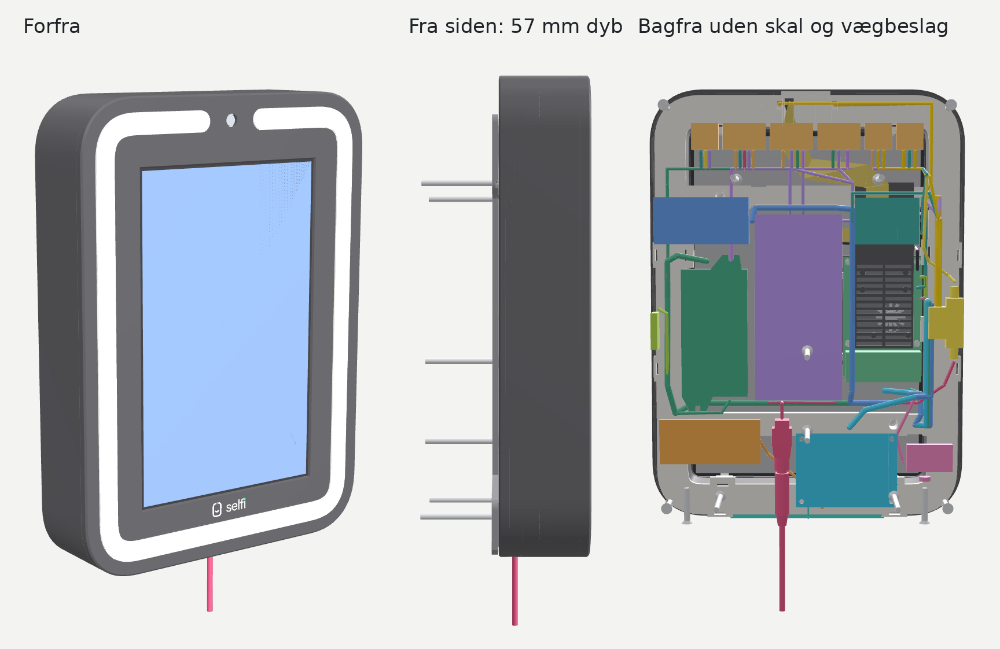
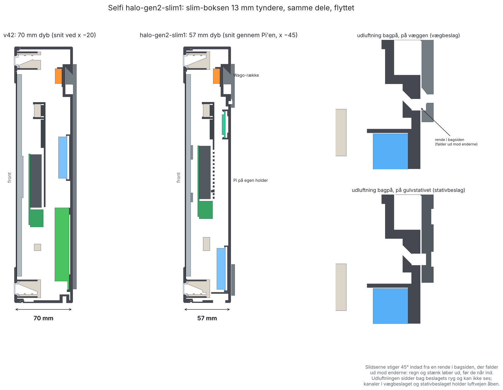

# Selfi Halo gen 2, slim4 (57 mm dyb): printguide

**Version:** halo-gen2-slim4 (4. nov. 2026). En **sekundær version ved siden af v45**, ligesom kb1 (kamera i bunden): v45 er stadig den gældende boks. Alle filer i denne mappe starter med `halo-gen2-slim4_`. CAD-kilden er `hardware/cad/gen2_slim.scad` i esbenchristensen/selfiebox. **slim4 er slim2 med de samme ændringer i lyskanalen som v45** (lommer til klipstikkene ved kameraet og en bro i hvert hjørne; se "Hvad er nyt i slim4"). slim3 er sprunget over (nummeret bruges til forlængerledningerne).

Printer: Bambu Lab H2C. **Print fra 3MF-filerne**; STL-filerne ligger også i printretning. Én del pr. plade, 1 stk. af hver. Alle dele i PLA, lysringen i klart materiale. Indstillingerne er de samme som i v42 (se v42's printguide, "Indstillinger").

## Hvad er nyt i slim4: plads til klipstikkene og broer i hjørnerne af lyskanalen (som v45)

Esben 4. nov.: *"de her stik og klipstik, som sidder for enden af stripsene, på nogle områder, der er de sidder placeringen på dem sådan, at de presser fronten væk fra LED-kanalen"* og *"vi skal sørge for, at det sidder fast, især rundt i hjørnerne. ... For man kan især se lyset, hvis ikke det sidder helt tæt op mod kanterne."* Han foreslog en tynd bro, som strippene kan køre under, og at starte med én i hvert hjørne.

Kun **bagrammen** og **lysringen** er ændret. Skal, front, Pi-holder, blæserhegn, vægbeslag, stativbeslag og temadele er de samme som i slim2 (samme STL'er og 3MF-indstillinger). Snittet `halo-gen2-slim4_snit_led.png` viser begge ændringer.

### Lommer til klipstikkene ved kameraet (bagramme og lysring)

v36 regnede med, at strippene blev loddet uden klipstik. Strippene, der bruges, har klipstik på den ende, der føres (hvid: 8 mm COB-startklips ca. 16 × 9,6 × 4,3 mm, RGB: 5 mm MiniClip 3-polet ca. 16,6 × 6,8 × 4,4 mm). Et klips er bredere end sin strip, så det ramte skillevæggene mellem banerne, trinnet foran hvid 1 og lysringens krave (hvid 1's klips nåede 0,3 mm ind over kraven), og så stod fronten ud.

- I begge ender af den øverste bane, fra kameraet og 21,5 mm ud (|x| 17 til 38,5), er trinnet, skillevæggene, læberne og RGB-knasterne skåret væk fra stripvæggen og 4,8 mm ind. Bunden er 1,1 mm dybere der (til RGB-klipsets bredde), og reflektorens fod er skåret lidt ned bagest.
- De første 4 mm ved kameraet er ledningsslidsen som før: ledningen går ud af klipsets ende mod kameraet og bøjer bagud gennem slidsen. Klipset ligger fra x 21 og udad.
- Lysringen har samme hak bag på sin yderste væg og krave i de samme 21,5 mm (0,6 mm dybt), så et klips ikke kan røre ringen. Ringens kant mod rammen, krave og fals er ellers uændret.
- Venstre side: hvid 1 og RGB. Højre side: hvid 2. Lommen er lige stor i begge sider, så alle tre strips kan føres fra begge ender.
- RGB-knasterne på den øverste bane er rykket ud af lommen: fra x ±30 og ±55 til ±46 og ±62.

### Broer i hjørnerne (bagramme)

- Én bro midt i hvert hjørne (ved 45°, 4 i alt): en tynd stang, 1,0 mm tyk og 1,6 mm bred, der står 0,25 mm over strippenes forside (hvid: over COB-buen, RGB: over RGB-strippen), på tværs af alle tre baner fra trinnet foran hvid 1 til bunden.
- Den er bundet til rammen fire steder: trinnet, de to skillevægge (i de mørke mellemrum mellem strippene, så intet krydser en strip) og bunden. Den er altså stiv og kan ikke knække af.
- Forfra ses kun dens ende, 1,6 × 1,0 mm, 3,7 mm bag diffuserens forside. Den er hvid som rammen.
- Den printes med rammen (bagsiden ned): en lodret søjle med 1,1 mm små broer ud til trinnet og skillevæggene, ingen support.

### Sådan sættes strippene i nu

1. Læg ledningen fra klipsets ende ind i slidsen ved kameraet, og læg klipset i lommen.
2. Læg strippen ned i sin bane langs den øverste bane, ned ad siden, og træk den **frie ende ind under broen** i hvert hjørne (frie ende først; klipsenden skal aldrig under en bro). Træk resten igennem, til strippen ligger tæt i hjørnet.
3. Ud igen: træk strippen tilbage fra klipsenden, så glider den ud under broerne uden at blive bøjet.

Hvid 1 og RGB føres fra venstre, hvid 2 fra højre, som før. RGB-strippens forlængerledning og dens stik bag på rammen kommer i en senere version (stiktypen og længderne venter på Esben).

### Hvad skal printes nyt

**Bagrammen** og **lysringen**. Hurtigsættet `halo-gen2-slim4-hurtig` har de to ændringer på plade 1: `klipslomme` (front, lysring og bagramme ved kameraet i venstre side) og `lyskanal` (lysstakken nederst til venstre, nu med broen i hjørnet).

Front og bagramme skal senere printes i ASA, fordi PLA blev blødt af varmen (Esben 4. nov.). Indtil spolerne og 3MF-indstillingerne er skiftet, er alle 3MF'er stadig PLA (lysringen klar PETG).

## Hvad var nyt i slim2: mikrofontænderne, strømstikkets kanal og sikringsholderen (som v43)

Kun tre ting i **skallen** er ændret, efter Esbens hurtigprint 4. nov. Det er de samme rettelser som i v43 på hovedlinjen. Alle andre dele er de samme som i slim1.

### Mikrofonkernens tænder (skallen)

*"De tænder, du har lavet for den, de passer egentlig fint nok på den og holder fint på den. De er bare lige en tand for tynde, så de knækker for den, når man sætter dem ned."*

- **Selve tanden er uændret**, så pasformen er den samme: 6 mm bred, går 0,45 mm ind over printets kant, 0,2 mm over printets top, samme skrå top og samme sted midt på hver kort ende.
- **Tungen under tanden er stærkere:** 10 mm bred (slim1 og v40–v42: 6 mm), 1,2 mm tyk ved roden og tilspidset bagpå op til de 0,8 mm ved tanden (siden ind mod kortet er lige som før), og en 0,5 mm affasning på begge sider af roden, hvor den knækkede (før var der et skarpt hjørne).
- Lommen i bagvæggen er 2,0 mm dyb (slim1 og v40–v42: 1,5; der er stadig 1,0 mm bagvæg tilbage), så tungen er 8,6 mm lang i stedet for 8,1. Roden er ca. 3,7 gange så stærk, og tøjningen, når tungen bøjer de 0,6 mm ud, er næsten den samme som før (ca. 1,2 % mod 1,1 %), fordi den er længere og tilspidset.
- Tryk kortet lige ned over pindene; vip det ikke ind under den ene tand først.

### Kanalen til strømforsyningens stik (skallen)

*"Kanalen, som strømstikket udefra skal op i, den er måske lige en millimeter i diameter for tynd. Så stikket det har svært ved at komme op."*

- Hullet nedefra er **Ø11,8** (slim1 og v40–v42: Ø10,8), stadig med den flade top 0,5 mm over cirklen og affasningen i bunden. Der er nu 0,8 mm luft om stikkets greb (Ø10,15) hele vejen rundt.
- Intet andet ved strømindgangen er ændret: bøjlen over hunstikket og foden om hullet er som v40. Foden var tegnet efter det gamle Ø12,5-hul, så der er stadig væg rundt om, og stativbeslagets slids til stikket (ved x 17,65) er 16 mm bred, så det går fri.

### Sikringsholderens åbninger i enderne (skallen)

*"Udgangen i hver ende af sikringsholderen er blevet for smalle og snævre, så sikringsholderen kan ikke komme derned i."* Du målte ledningsstudsene til ca. 8 mm i begge ender, "måske 7,5".

- Slidserne i begge endevægge er **7,5 mm brede** (slim1 og v40–v42: 5,6; v36–v39: 9), så de klemmer 0,25 mm på hver side af studsen. Affasningen øverst i slidserne følger med.
- Lommen (13,38 mm uden luft) og knusribberne (0,5 i siderne, 0,4 i enderne) er som v40.

### Hvad skal printes nyt i slim2

Kun **skallen**. Alle andre dele er de samme som i slim1. Hurtigsættet `halo-gen2-slim4-hurtig` har de tre ændringer på plade 1 sammen med slim1's nye steder (udluftningen og det, der er flyttet), da slim1 ikke er printet endnu.

## Hvad er slim1

Esben 3. nov.: "Vi vil gerne have den så tynd som muligt", varmen klares med "mere vejrsikker udluftning bagpå, bag vægbeslaget, så man ikke kan se det, hvis den er på stativ", og "du må ikke bytte ting ud i den, men du må gerne flytte på alt". 4. nov. valgte han 57 mm med Pi'en flyttet.

- **Boksen er 57 mm dyb** (v42: 70 mm), altså 13 mm tyndere. Front, lysring, skærm og kamera er de samme; skallen, bagrammen og alt bag dem er lavet om til den nye dybde.
- **Ingen dele er byttet ud.** Det er de samme købedele som v42: RSD-60G-5, Gledopto, DFR0457, XVF3800, højttaler, 4G, Wago og sikringsholder. De er flyttet, så de ligger ved siden af hinanden i stedet for bag hinanden.
- **Pi'en sidder på sin egen holder** lavt i venstre side (v42: midt på skærmens afstandsstykker, med 5 V-forsyningen bag sig). Det er den ene nye del, og den kræver et længere fladkabel til skærmen (se "Køb").
- **Ny udluftning bagpå** bag vægbeslagets ryg: en rende i bagsiden, der falder ud mod enderne, og slidser, der stiger 45° indad fra den. Regn og stænk løber ud, før de når ind, og den kan ikke ses, hverken på væggen eller på gulvstativet. Vægbeslaget og stativbeslaget har kanaler ud for slidserne, så luften kan komme ud.

### Hvad skal printes nyt

Alt undtagen lysringen er nyt, fordi skallen er 13 mm kortere, og alt, der går rundt om den, følger med.

| Del | slim1 | Hvorfor |
|---|---|---|
| **Skal** | **Ny** | 51 mm høj på pladen (v42: 64). Alle holdere er flyttet (tabellen under "Indretning"), udluftningen bagpå er ny, slidserne i bunden er 15 mm lange, og de 2 gamle dyvler bagpå er væk. |
| **Pi-holder** | **Ny del** | Pi'en skrues på holderen med 4 M2,5 × 6, og holderen skrues på skærmens 2 højre afstandsstykker med skærmsættets egne 2 skruer. De 2 venstre afstandsstykker går gennem huller i holderen. |
| **Bagramme** | **Ny** | Venstre side-låse (mellem bagramme og front) er flyttet fra 110 og 190 mm op til **138 og 192 mm**, så Pi'ens USB-porte og ledningerne på GPIO-stikket går fri. K1's slids er flyttet til x −80. Udskæringen til USB-stikkene i det nederste tværstykke er væk (Pi'en sidder ikke længere der). |
| **Front** | **Ny** | Låsenes vinduer følger bagrammens låse i venstre side. Ellers som v42. |
| **Blæserhegn** | **Ny** | 10 mm smallere og flyttet med Pi'en (midt over x −53,5). Klikkes stadig på det øverste tværstykke. |
| **Vægbeslag** | **Ny** | Kanaler (1,5 mm dybe) ud for udluftningen. Tunger og skinne som v42. |
| **Stativbeslag** | **Ny** | Hylden er 13 mm kortere (41 mm på pladen, v42: 54), slidsen til strømstikket er flyttet til x 17,65, og der er kanaler ud for udluftningen. Gevindindsatsen er som v42. |
| **Tema-dele og Dominance** | **Nye** | Stropperne går rundt om den tyndere boks (64,1 mm i stedet for 77,1). |
| Lysring | Samme del som v42 | En printet v42-ring kan bruges. |

Wago-rækken til eftermontering (`wagoraekke-eftermontering`) er ikke med: den var til skaller fra v24–v28.

### Indretning (set bagfra med skallen åben, mål i mm fra boksens bund og midte set forfra)

| Del | Hvor | v42 |
|---|---|---|
| 5 V-forsyning (RSD-60G-5) | Står mellem tværstykkerne til højre for Pi'en, x −24 til 36, 90–218 oppe. DC IN foroven, DC OUT forneden, skruerne fremad | Bag Pi'en |
| RGB-styring (Gledopto) | Til højre for forsyningen, x 41–87, 83–191 oppe | Venstre side |
| 4G-modem (tilvalg) | Vendt på tværs over Gledopto'en, x 40–105, 198–230 oppe | Venstre væg |
| Dæmper (DFR0457) | Fladt på bagvæggen øverst til venstre, x −77 til −33, 198–230 oppe. Skrueklemmerne i venstre ende, Gravity-stikket i højre | Venstre væg, stående |
| Sikringsholder | Liggende på siden mod venstre væg, 119–169 oppe, ledninger ud i begge ender | Højre væg, stående |
| Mikrofonkerne (XVF3800) | Lavt til venstre over de venstre slidser i bunden, x −63 til 8, 15–67 oppe | Bag Pi'en |
| Højttaler (tilvalg) | Lavt til højre, x 33–102, 46–77 oppe; gitteret fri af vægbeslagets ryg | Venstre side |
| Strømindgang | I bunden ved **x 17,65** (mellem mikrofonkernen og højttaleren) | Midt i bunden |
| Stødsensor (tilvalg) | På højre sidevæg, 125–150 oppe | Bagvæggen |
| Reed (tilvalg) | Lavt til venstre ved låsen, 3 mm længere til venstre end v42 | Samme sted |
| Wago-rækken | Som v42, på vægbeslagets klods | Som v42 |
| Pi 5 | På Pi-holderen: x −81,5 til −25,5, 101–188,5 oppe. GPIO-stikket i venstre kant, **ben 1 øverst**, USB-portene nedad, USB-C i højre kant 11 mm under toppen | Midt på skærmen |

### Køb (ud over v42's liste)

- **Skærmkabel: Raspberry Pi Display Cable, 200 mm** (22-polet mini til mini, det til Pi 5). Det, der følger med skærmen, er for kort, nu hvor Pi'en sidder ude til venstre.
- **4 skruer M2,5 × 6** (Pi'en på holderen; skruerne skærer selv gevind i holderens Ø2,2-huller).
- **Frontskruer 4,0 × 40 T20, forsænkede** (4 stk.) i stedet for 4,0 × 50: en 50 mm skrue ville stikke 1,8 mm ud gennem forsiden i den tyndere boks.
- **Skærmens strøm (G4):** kablet fra Pi'ens ben 2 og 6 til skærmen er nu ca. 14 cm. Rækker skærmens eget kabel ikke, så brug 2 dupont-ledninger hun-hun på 20 cm.
- Alt andet som v42. USB-A-kablerne er de samme 90°-vinklede (kablet til venstre), men U1 og U3 skal være **mindst 55 cm**.

### Ledninger: nye længder

Fra `render/harness_slim.py` (rute + bøjninger + 15 mm i hver klemme, rundet op til 5 cm). Alle ledninger er lagt i deres baner og tjekket fri af alle dele i 3D (ingen ledning går gennem en holder, en væg eller en købedel). Se `halo-gen2-slim4_ledningsplan.png`.

| Kabel | Fra → til | Skær (mm) | v42 |
|---|---|---|---|
| P1 | hunstik + → sikringsholder (nederste ende) | 250 | 400 |
| P1b | sikringsholder (øverste ende) → W1 | 350 | 250 |
| P2 | hunstik − → W2 | 450 | 400 |
| P3 / P4 | W1 / W2 → 5 V-forsyning +Vin / −Vin | 150 / 150 | 300 / 300 |
| P5 / P6 | 5 V-forsyning +V / −V → W3 / W4 | 350 / 350 | 500 / 450 |
| P7 / P8 | broer W4 → W2 / W2 → W5 | 100 / 200 | 100 / 200 |
| P9 / P10 / P11 | W1 → dæmper VIN / W2 → GND / VOUT → W6 | 300 / 250 / 150 | 450 / 400 / 350 |
| P12 | W3 + W4 → Pi USB-C (pigtail), gennem K1 | 500 | 550 |
| P13 / P14 | W3 / W4 → Gledopto V+ / V− | 450 / 400 | 400 / 450 |
| S1–S7 | strippenes egne ledninger gennem K1 | 450–600 | 400–550 |
| U1 / U2 / U3 | Pi USB-A → Gledopto / mikrofonkerne / 4G, gennem K2 | 550 / 350 / 500 | 450 / 550 / 450 |
| G1 / G2 / G3 / G4 | Pi-ben → dæmper (K1) / reed (K2) / stødsensor (K2) / skærm | 350 / 350 / 600 / 150 | 400 / 400 / 600 / 100 |
| A1 | højttaler → mikrofonkernens SPEAKER | 100 | 100 |

Hængselbundterne: **K1 180 mm** mellem stropperne (bagrammens øverste tværstykke x −80 → skallens løkke 215 mm oppe i venstre side), **K2 200 mm** (nederste tværstykke x −76 → løkken 92 mm oppe). Strip-ledningerne skal stadig være **mindst 60 cm** (S3 til Gledopto'en er den længste).

### CAD-tjek (4. nov. 2026)

- `tools/check_fit_gen2.py` med `GEN2_SCAD=cad/gen2_slim.scad`: **ingen nye kollisioner**, og alle afstande er over deres minimum. De nye mindsteafstande: Pi'ens venstre kant 0,85 mm fra bagrammens låsearme, Pi-holderen 0,85 mm fra bagrammen, 5 V-forsyningen 4,3 mm fra tværstykkerne, Gledopto'en 3,8 mm fra højre låses pude, dæmperen 8,4 mm bag blæserhegnet, de lukkede Wago-håndtag 4,1 mm fra bagrammens øverste kant.
- **Samling:** hver del kan sættes i rækkefølge. Stikkene på Pi'ens GPIO-ben (z 156–182) går fri af bagrammens låse (puderne sidder nu ved 129–147 og 183–201). Pi'ens USB-C-stik ligger foran 5 V-forsyningen (forsyningens bakke er skåret fri over det). Wago-håndtagene kan kun åbnes, når boksen er åben, som før.
- Alle dele er ét lukket legeme, og alle 3MF'er er bygget med v42's indstillinger.
- Ikke testet på en rigtig boks endnu. Hurtigsættet (`halo-gen2-slim1-hurtig`) prøver det nye først.

## Delene

| Fil | Del | Mål på pladen (mm) | Materiale | Plade | Support |
|---|---|---|---|---|---|
| `halo-gen2-slim4_front.stl` (+ `_front_flerfarvet.3mf`) | **Ny.** Som v42, låsevinduerne i venstre side flyttet | 224,5 × 307 × 27,7 | PLA sort + hvid + grøn | Tekstureret PEI | Nej |
| `halo-gen2-slim4_logo-hvid.stl` / `_logo-groen.stl` | Logoets farvedele til fronten | | PLA hvid / grøn | Sammen med fronten | Nej |
| `halo-gen2-slim4_lysring.stl` (+ `.3mf`) | Samme ring som v42 | 209,1 × 291,6 × 6,7 | Klar PETG | Tekstureret PEI | Nej |
| `halo-gen2-slim4_bagramme.stl` (+ `.3mf`) | **Ny.** Venstre låse ved 138 og 192 mm, K1 ved x −80, ingen USB-udskæring | 217,1 × 300 × 29,2 | PLA hvid | Glat PEI | Nej |
| `halo-gen2-slim4_pi-holder.stl` (+ `.3mf`) | **Ny del.** Forsiden ned, tappe og ører op | 110,7 × 78 × 9,5 | PLA sort | Glat PEI | Nej |
| `halo-gen2-slim4_blaeserhegn.stl` (+ `.3mf`) | **Ny.** Smallere, flyttet med Pi'en | 115,5 × 14,7 × 41 | PLA sort | Glat PEI, på siden | Nej |
| `halo-gen2-slim4_skal.stl` (+ `_skal_support.3mf`) | **Ny.** 57 mm dyb, alt flyttet, udluftning bagpå | 224,5 × 307 × 51 | PLA sort | Glat PEI | Kun skinnens udsparing (se under) |
| `halo-gen2-slim4_vaegbeslag.stl` (+ `.3mf`) | **Ny.** Kanaler ud for udluftningen | 189 × 284,5 × 19,5 | PLA sort | Glat PEI | Nej |
| `halo-gen2-slim4_stativbeslag.stl` + logo (+ `_stativbeslag_flerfarvet.3mf`) | **Ny.** Kortere hylde, stikslids ved x 17,65, kanaler | 222,5 × 304 × 41 | PLA sort + hvid + grøn | Tekstureret PEI | Nej |
| `halo-gen2-slim4_tema-*` og `_tema-dominance-*` | **Nye.** Stropperne rundt om den tyndere boks | | PLA | Glat PEI | Under stropperne |

**Skallens support:** 3MF'en har kun én support-enforcer, i **skinnens udsparing** øverst bagpå (som v42). v42's anden enforcer under dæmperbakkens forvæg er væk, fordi dæmperen nu ligger fladt på bagvæggen. Blockerne ved låselommerne og vingelommerne er som v42. Udluftningens rende er en bro på 5,5 mm, og slidserne stiger 45°, så de printes uden support.

Tegninger kopieret fra v42, fordi de dele er de samme: `halo-gen2-slim4_laas.png`, `_rille.png`, `_snit_kroge.png`, `_snit_lysring.png`, `_styrketest_kroge.md`. Ledningsdiagrammet (`_ledningsdiagram.png`) og Pi-benene (`_pi-ben.png`) er de samme forbindelser som v42.

## Samling

Som v42. Det, der er anderledes, er markeret **slim1**.

1. **Lysringen og skærmen** i fronten som v42.
2. **Strips og kamera** som v45 (klipsene i lommen ved kameraet, strippene trukket ind under broerne i hjørnerne) (kamerakablet 300 mm, i en blød bue gennem slidsen øverst i bagrammen).
3. **Bagrammen** ned i fronten, til alle låse klikker. Skærmen skrues fast med 4 M2,5 × 3–4 mm.
4. **slim1: Pi'en.** Skru Pi'en på Pi-holderen med 4 M2,5 × 6 (komponenterne væk fra holderen, USB-portene mod holderens nederste kant). Sæt det **200 mm skærmkabel** i skærmens stik og i Pi'ens DISP-stik, og kamerakablet i CAM-stikket, **før** holderen skrues på. Læg holderen over skærmens 4 afstandsstykker, så de 2 venstre går gennem hullerne og de 2 højre ind i ørerne, og skru den fast i de 2 højre med skærmsættets skruer. Skærmkablet ligger fladt mellem skærmens bagside og blæserhegnet og folder ned i Pi'ens stik.
   - **Blæserhegnet** klikkes på det øverste tværstykke midt over Pi'en. Tjek, at blæseren kan drejes med en finger gennem risten.
   - **GPIO:** dæmperen på ben 1, 12, 14 og skærmen på ben 2, 6 som v42 (`halo-gen2-slim4_pi-ben.png`; Pi'en vender som i v42). Ledningerne går op langs venstre kant (bane GL) til K1 eller ned til K2.
   - **USB-A:** de 3 vinklede stik (kablet mod venstre) i Pi'en før bagrammen lukkes; kablerne går til K2 på det nederste tværstykke.
   - **Pi'ens strøm (P12):** fra K1 under det øverste tværstykke, foran blæserhegnet og ned til USB-C i Pi'ens højre kant. Den må ikke ligge over hegnet.
5. **Elektronik i skallen**, i denne rækkefølge, så intet står i vejen: **strømindgangen** (hunstikket forfra i kanalen ved x 17,65), **mikrofonkernen** og **højttaleren** forneden, **sikringsholderen** på siden i venstre side, **5 V-forsyningen** i sin bakke (forbind P3/P4 foroven og P5/P6 forneden, før Gledopto'en sættes i), **Gledopto'en**, **dæmperen** fladt øverst til venstre, **4G** på tværs øverst til højre, **stødsensoren** på højre væg og **reed** forneden ved låsen. Til sidst Wago-rækken efter `halo-gen2-slim4_ledningsdiagram.png`. Mål 24 V og 5 V, før strips og Pi sættes i.
6. **Hængselbundterne:** K1 stroppes i skallens løkke 215 mm oppe i venstre side og om det øverste tværstykke ved x −80, **180 mm** mellem stropperne. K2 i løkken 92 mm oppe og om det nederste tværstykke ved x −76, **200 mm**. Åbn kassen helt: intet må stramme.
7. **Mikrofonkortet** i lommen i bunden som v42; det flade kabel går op til kernens underkant foran den.
8. **Skallen** lukkes over fronten og klikker; **4 frontskruer 4,0 × 40 T20** bagfra.
9. **Ophængning:** vægbeslag eller stativbeslag som v42. Tjek, at beslagets kanaler står ud for udluftningens slidser (de kan ikke sættes forkert på).

## Tjek på første print (slim1)

- Går alle låse mellem front og bagramme i, og kan de vippes fri? (Venstre side er flyttet.)
- Sidder Pi'en fast på holderen, og rører Pi'ens venstre kant ikke bagrammen, når den er klikket i?
- Kan skærmkablet ligge uden knæk, og sidder alle Dupont-stik på GPIO-benene uden at blive trykket af bagrammen?
- Rækker alle ledninger med kassen helt åben, og ligger ingen ledning over blæserhegnet?
- **Varme:** kør boksen 1 time med preview og lys tændt i rummet og se CPU-temperaturen i admin. v42 lå på 63–64 °C med den stille blæserkurve; slim1 må gerne ligge lidt højere, men skal holde sig under 75 °C. Mål også 5 V-forsyningens overflade (den sidder nu tæt på Pi'en).
- **Udluftningen:** hæld lidt vand i renden bagpå med boksen stående: det skal løbe ud i enderne uden at komme ind.
- Resten af v42's tjekliste gælder også.
